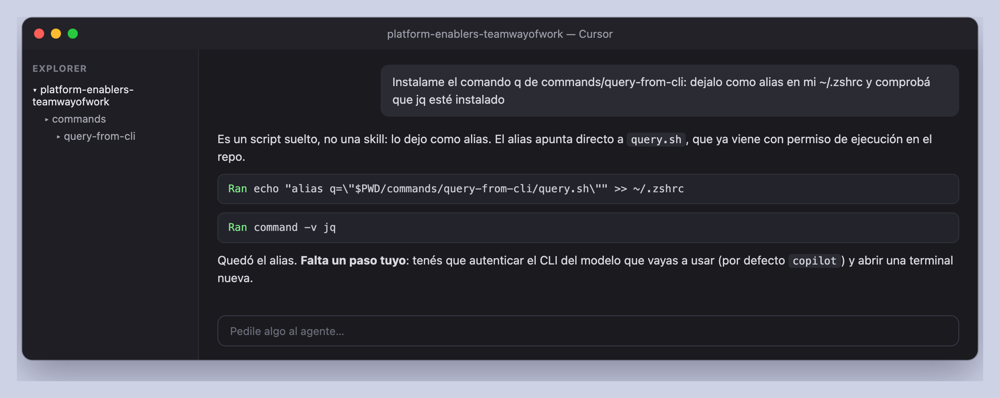

# query-from-cli

> 🚧 **Fase: Beta.** Se usa de verdad para consultas rápidas del día a día, pero el prompt y las opciones todavía se ajustan con el uso. Apoyate y avisá si algo rompe. Ver el [ciclo de vida](../../README.md#ciclo-de-vida).

Un `q` para hacerle una pregunta rápida a un modelo de IA desde la terminal, sin abrir una sesión interactiva. **Es un comando,
no una skill**: no se enlaza a `~/.agents/skills/` y no lo invoca un agente; lo escribís vos en tu terminal. Lo que sí le
podés pedir al agente de Cursor es que lo instale y lo compruebe.

| Le decís… | Y pasa… |
|---|---|
| *(al agente)* «Instalame el comando `q`» | deja un alias en tu `~/.zshrc` y comprueba que `jq` esté (lo necesita `--model=codex`) |
| *(al agente)* «Comprobá que `q` responde» | corre `q` con un modelo inexistente: prueba el script sin llamar a ningún modelo |
| *(en tu terminal)* `q "comando para …"` | consulta a `copilot` (el modelo por defecto) en modo liviano y devuelve texto plano |
| *(en tu terminal)* `q --model=claude\|codex\|gemini "…"` | lo mismo con el CLI que elijas, sin MCPs, plugins ni skills |

**Qué toca y qué no:** el script solo corre el CLI del modelo y imprime su respuesta; no escribe archivos. Pero «liviano» **no es**
«sin herramientas»: el modo de `copilot` se lanza con `--allow-all-tools` (ver los [límites](docs/showcase.md#qué-protege-y-qué-no)).

## Elegí por dónde empezar

| Pieza | Qué resuelve | Escribe | Se instala con | Showcase | Instalación |
|---|---|---|---|---|---|
| **`query.sh`** (el alias `q`) | Una pregunta de una línea a un modelo, sin contexto de agente | No | un alias en `~/.zshrc` | [Ver el caso](docs/showcase.md#1-una-pregunta-rápida-desde-la-terminal) | [Instalar](docs/instalacion.md#1-instalar) |
| **`--model=`** | Elegir `claude`, `codex`, `copilot` o `gemini` | No | viene con el script | [Ver el caso](docs/showcase.md#2-elegir-el-modelo) | [Instalar](docs/instalacion.md#2-autenticar-el-modelo-que-vas-a-usar) |

## Un ejemplo: instalarlo desde Cursor

El agente deja el alias y avisa del único paso que es tuyo. La conversación es una maqueta.



## Qué documento leer

| Si querés… | Leé | Qué encontrás |
|---|---|---|
| **Instalarlo desde Cursor** | [Instalación y primer uso](docs/instalacion.md) | Prompts para instalar y comprobar, y el paso manual (autenticar el modelo) |
| **Instalarlo comando por comando** | [Instalación detallada](docs/instalacion-detallada.md) | Requisitos, alias o symlink y qué argumentos recibe cada CLI |
| **Ver todo lo que hace** | [Showcase](docs/showcase.md) | Cada uso en un escenario, qué protege y qué no |
| **Consultar un detalle** | [Referencia](docs/referencia.md) | El README original: cuándo usarlo, uso, requisitos |

## En tres comandos

```bash
git clone git@github.com:josefigueredo/teamwayofwork.git && cd teamwayofwork
echo "alias q=\"$PWD/commands/query-from-cli/query.sh\"" >> ~/.zshrc      # abrí una terminal nueva después
q "decime hola"                                                                  # necesita el CLI del modelo autenticado
```

Requisitos: `bash`, el CLI del modelo que uses autenticado y, solo para `--model=codex`, `jq`.

## Desarrollo

```bash
python3 tests/test_docs_links.py     # los links de estos docs, desde la raíz del repo
```

El script no tiene tests propios.
