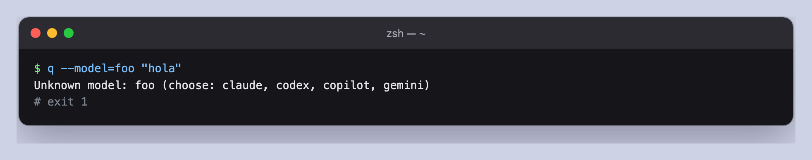
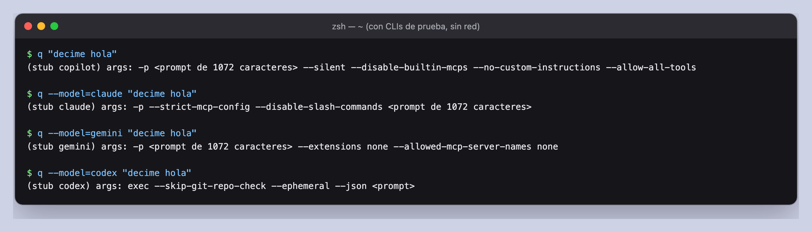

# Instalación detallada: comando por comando

> **¿Solo vas a usarlo desde Cursor?** Tenés la [instalación simple](instalacion.md), que usa prompts para instalarlo y
> comprobarlo. Esta guía es para quien quiere ver (o correr) cada comando.

| Paso | Qué hacés |
|---|---|
| [1. Requisitos](#1-requisitos) | `bash`, el CLI del modelo, `jq` para codex |
| [2. Instalar](#2-instalar) | Alias o symlink |
| [3. Comprobar](#3-comprobar) | Sin llamar a ningún modelo |
| [4. Qué recibe cada CLI](#4-qué-recibe-cada-cli) | Los argumentos exactos |

> **Sobre las capturas.** Salen de correr el `query.sh` real de este repo. Los CLIs de modelo (`claude`, `gemini`, `copilot`,
> `codex`) son **scripts de prueba** puestos primero en el `PATH`, que solo imprimen los argumentos que recibieron: no hubo red ni
> modelos, y por eso no hay ninguna respuesta de un modelo en estas guías.

---

## 1. Requisitos

| Qué | Sin esto |
|---|---|
| `bash` | El script usa `#!/usr/bin/env bash` y `set -euo pipefail` |
| El CLI del modelo elegido (`claude`, `codex`, `copilot` o `gemini`) instalado y autenticado | Ese `--model` no corre |
| `jq` | `--model=codex` no puede extraer la respuesta del JSON que devuelve |

`copilot` es el standalone de `@github/copilot` (npm, Homebrew o el script de instalación), no la extensión de `gh`.

## 2. Instalar

```bash
git clone git@github.com:josefigueredo/teamwayofwork.git && cd teamwayofwork

# opción A: alias (la ruta se expande ahora porque el comando va entre comillas dobles)
echo "alias q=\"$PWD/commands/query-from-cli/query.sh\"" >> ~/.zshrc

# opción B: symlink en un directorio de tu PATH
ln -s "$PWD/commands/query-from-cli/query.sh" ~/.local/bin/q
```

Dos cosas a tener en cuenta, ambas verificadas:

1. **`query.sh` ya es ejecutable en el repo** (modo `100755`): el alias y el symlink lo llaman directo, sin `bash` ni `chmod +x`.
   Lo comprobamos corriendo `q --model=foo hola` por la ruta directa y por un symlink: los dos dan `Unknown model: foo` y salen con
   código 1. (Si tu clon es anterior a que se le diera permiso de ejecución, verás `permission denied`, código 126: actualizalo.)
2. **Las comillas del alias.** Con `echo 'alias q="$PWD/…"'` (comillas simples) se escribe un `$PWD` literal en `~/.zshrc`, que zsh
   expande al abrir cada terminal: apunta a la carpeta donde estés, no al clon. Con comillas dobles de afuera, como arriba, queda
   la ruta completa.

## 3. Comprobar

```bash
q --model=foo "hola"      # no llama a ningún modelo
```



Sin argumentos, `q` imprime su ayuda y sale con código 1. La ayuda termina de decir «Defaults to copilot», que es el modelo por
defecto (`DEFAULT_MODEL="copilot"`).

## 4. Qué recibe cada CLI

Con los CLIs de prueba, esto es lo que `query.sh` les pasa (el prompt completo, de 1072 caracteres para `q "decime hola"`,
se muestra abreviado):



| Modelo | Argumentos (además del prompt) |
|---|---|
| `copilot` (por defecto) | `-p <prompt> --silent --disable-builtin-mcps --no-custom-instructions --allow-all-tools` |
| `claude` | `-p --strict-mcp-config --disable-slash-commands <prompt>` |
| `gemini` | `-p <prompt> --extensions none --allowed-mcp-server-names none` (errores a `/dev/null`) |
| `codex` | `exec --skip-git-repo-check --ephemeral --json <prompt>`, y `jq` extrae el texto de los eventos `item.completed` |

El prompt que el script antepone a tu pregunta pide texto plano para terminal (sin markdown), el mismo idioma que la pregunta, una
sola pasada sin preguntas de vuelta, y herramientas solo si la pregunta realmente exige mirar el entorno.
