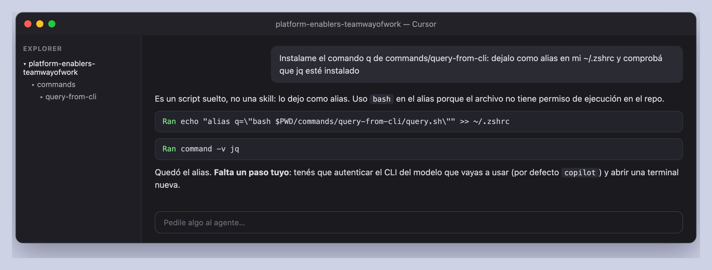
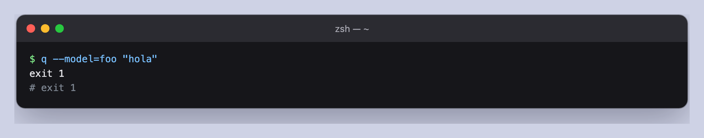

# Instalación y primer uso, desde Cursor

> **Una adaptación a propósito.** Las demás guías de este repo se cuentan solo con prompts al agente. Esta no puede: `q` es un
> **comando que escribís en tu terminal**, no una skill que el agente invoca. Entonces los prompts sirven para **instalarlo y
> comprobarlo**, y el uso de todos los días es tuyo, en la terminal.

Dos cosas **no** son un prompt, y es a propósito:

- **Autenticar el CLI del modelo** (`copilot`, `claude`, `codex` o `gemini`) es un inicio de sesión con tu cuenta: lo hacés vos,
  según la documentación de ese CLI, y ningún token pasa por el chat.
- **Usar `q`** es escribir `q "…"` en una terminal. Si se lo pedís al agente, estás consultando a un modelo a través de otro.

> ¿Preferís ver cada comando? Está la [instalación detallada](instalacion-detallada.md). Para ver todo lo que hace, el
> [showcase](showcase.md).

| Paso | Qué hacés | Cómo |
|---|---|---|
| [1. Instalar](#1-instalar) | Dejar el alias `q` en tu `~/.zshrc` | Un prompt |
| [2. Autenticar el modelo que vas a usar](#2-autenticar-el-modelo-que-vas-a-usar) | Iniciar sesión en el CLI | Manual |
| [3. Comprobar](#3-comprobar) | Probar el script sin llamar a ningún modelo | Un prompt |
| [4. Primer uso](#4-primer-uso) | Tu primera pregunta | En tu terminal |
| [5. Mantenerlo al día](#5-mantenerlo-al-día) | Traer la versión nueva | Un prompt |

> **Sobre las capturas.** Son **maquetas** de Cursor y el texto del agente es ilustrativo. Los comandos de los bloques `Ran` no
> muestran salida (el alias no imprime nada). El paso 3 muestra salida **real** del script. Ningún modelo se llamó para armar estas
> guías. [Tabla con el origen de cada imagen](#de-dónde-sale-cada-captura).

---

## 1. Instalar

Necesitás `bash` y tu clon de `teamwayofwork` abierto en Cursor. Pedile:

> Instalame el comando q de commands/query-from-cli: dejalo como alias en mi ~/.zshrc y comprobá que jq esté instalado



*Maqueta; los comandos no imprimen salida.*

Qué pasó:

- **Un alias**: `alias q="bash <ruta-a-tu-clon>/commands/query-from-cli/query.sh"`. Usa `bash` porque `query.sh` está versionado
  **sin permiso de ejecución**: sin `bash` (o un `chmod +x`), ejecutarlo directo da `permission denied`.
- **La ruta quedó fija** (se expandió al escribirla). Si mudás el clon de carpeta, actualizá el alias.
- **`jq`** solo hace falta para `--model=codex`. Si falta, pedile `brew install jq`.

Abrí una terminal nueva para que el alias exista.

## 2. Autenticar el modelo que vas a usar

Esto lo hacés vos. Sin `--model`, `q` usa `copilot`; con `--model=` podés elegir `claude`, `codex` o `gemini`. Para el que vayas a
usar, instalá su CLI e iniciá sesión siguiendo la documentación oficial de ese CLI (no se verificó acá cómo se hace en cada uno).
Un CLI sin sesión hace que ese `--model` no responda.

## 3. Comprobar

Esta prueba **no llama a ningún modelo**: usa un nombre de modelo que no existe.

> Corré q con un modelo inexistente para comprobar que el script responde: q --model=foo hola



*Salida real del script (sin red).* Si ves ese mensaje y código 1, el alias y el script andan.

## 4. Primer uso

En una terminal (no en el chat):

```bash
q "decime hola"
```

Responde el modelo por defecto (`copilot`), en el idioma de tu pregunta y en texto plano. Hay más casos en el [showcase](showcase.md).

## 5. Mantenerlo al día

> Actualizá mi clon de teamwayofwork con lo último de main

El alias apunta al archivo dentro de tu clon, así que no hace falta reinstalar.

---

## Si algo falla

| Síntoma | Causa probable | Qué hacer |
|---|---|---|
| `q: command not found` | La terminal se abrió antes de crear el alias | Abrí una terminal nueva |
| `permission denied` (código 126) | Ejecutás `query.sh` directo y no tiene permiso de ejecución | Usá el alias con `bash`, o `chmod +x` |
| `Unknown model: …` | `--model` con un valor que no es `claude`, `codex`, `copilot` ni `gemini` | Corregí el valor |
| El modelo no responde | CLI sin instalar o sin sesión | Paso 2 |
| `jq: command not found` con `--model=codex` | Falta `jq` | `brew install jq` |
| El alias apunta a una carpeta equivocada | Se escribió con comillas simples (`$PWD` literal) o mudaste el clon | Reescribí el alias con la ruta completa |

## De dónde sale cada captura

| Imagen | Origen |
|---|---|
| `cursor-instalar.png` | Maqueta; los comandos no imprimen salida |
| `terminal-error.png` | Salida real de `query.sh --model=foo hola` (sin red) |

Los HTML de origen están en [`img/src/`](img/src/).
