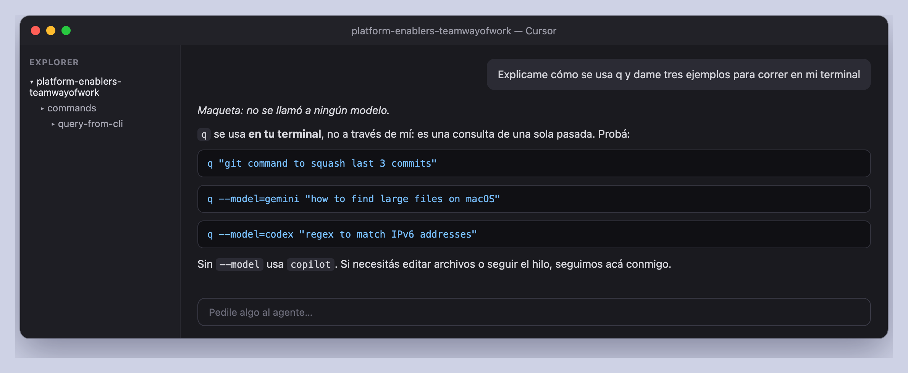
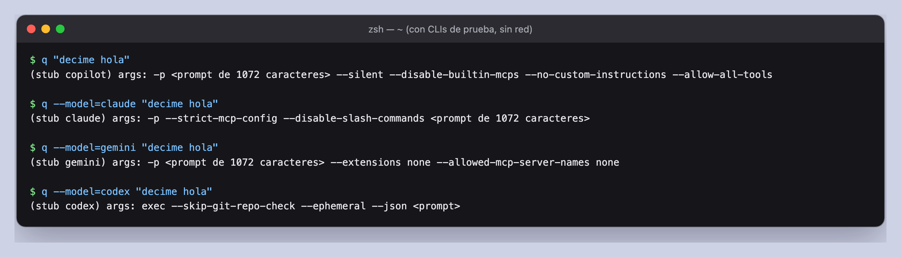
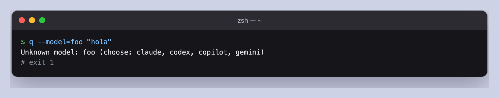

# Showcase

Qué se puede hacer con `query-from-cli`, escenario por escenario. Es un comando para tu terminal, así que a diferencia de otras
piezas del repo el «qué le decís al agente» se reduce a instalarlo y comprobarlo; el resto lo escribís vos. Para instalarlo, la
[guía con prompts de Cursor](instalacion.md) o la [detallada](instalacion-detallada.md); para el README original, la
[referencia](referencia.md).

| Pieza | Escenario | Ir al caso |
|---|---|---|
| `q "…"` | Un comando de `git`, una regex, un flag que no recordás | [Pregunta rápida](#1-una-pregunta-rápida-desde-la-terminal) |
| `--model=` | Elegir `claude`, `codex`, `copilot` o `gemini` | [Elegir el modelo](#2-elegir-el-modelo) |

> **Sobre las salidas.** Ninguna respuesta de un modelo es real en estas guías: **no se llamó a ningún modelo**. Lo real es la
> ayuda, el error de modelo desconocido y los argumentos que el script le pasa a cada CLI (capturados con CLIs de prueba, sin
> red). Las respuestas de los ejemplos son texto ilustrativo.

---

## Lo que lo distingue

| | |
|---|---|
| **De una sola pasada** | Corre el CLI en modo no interactivo (`-p`, `exec`): no hay forma de responderle |
| **Liviano** | Sin MCPs ni plugins ni skills, según las opciones de cada CLI |
| **Texto plano** | El prompt pide salida sin markdown, lista para leer o pegar en una terminal |
| **Mismo idioma** | Responde en el idioma de tu pregunta |
| **Sin contexto de agente** | No arrastra la sesión que tengas abierta |

---

## 1. Una pregunta rápida desde la terminal

**Pieza:** `q` · **Escribe:** no (el script solo imprime la respuesta).



*Maqueta; no se llamó a ningún modelo.*

```bash
q "git command to squash last 3 commits"
```

Si tu pregunta es ambigua, el modelo no se queda esperando: responde con su mejor interpretación y anota el supuesto; si de
verdad le falta contexto, termina con una línea que te pide volver a correr el prompt con el detalle que falta.

**Cuándo no:** si necesitás editar archivos, correr comandos o mantener contexto entre turnos, usá el agente normal.

## 2. Elegir el modelo

**Pieza:** `--model=` · **Escribe:** no.

```bash
q --model=gemini "how to find large files on macOS"
q --model=codex "regex to match IPv6 addresses"
```

Cada modelo recibe el mismo prompt con sus propias opciones de modo liviano:



*Real: lo que `query.sh` le pasa a cada CLI, capturado con CLIs de prueba. `codex` además pasa por `jq`.*

**Si falla:** un nombre desconocido corta con un mensaje y código 1, sin llamar a nada:



---

## Qué protege y qué no

| Te protege de… | Cómo |
|---|---|
| Arrastrar el contexto de tu sesión de agente | Cada consulta es independiente |
| Cargar MCPs, plugins y skills en una consulta tonta | Las opciones de cada CLI los desactivan |
| Un modelo mal escrito | Cualquier valor fuera de la lista termina con error y código 1 |

| **No** te protege de… | Por qué |
|---|---|
| Que el modelo use herramientas | «Liviano» no es «sin herramientas»: `copilot` se lanza con `--allow-all-tools`, y el prompt solo le pide usar herramientas si la pregunta lo exige. Es una petición, no un bloqueo |
| Una respuesta incorrecta | Es la respuesta de un modelo: verificala antes de ejecutar lo que te sugiere |

**Cuando algo falla:** un CLI sin instalar o sin sesión hace que ese `--model` no corra; con `--model=codex` sin `jq`, no se puede
extraer la respuesta.
