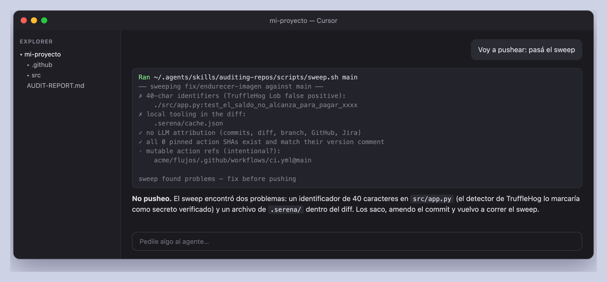

# auditing-repos

> 🧪 **Fase: Incubation.** Se usó en una auditoría completa y ya sobrevivió a dos rondas de review, pero es nueva y cambia rápido. Usala y reportá lo que encuentres; todavía no construyas encima. Ver el [ciclo de vida](../../README.md#ciclo-de-vida).

Una skill para Claude Code, Codex, Copilot CLI, Cursor y Gemini CLI que audita un repositorio local, escribe los hallazgos
en un informe, espera tu aprobación y recién entonces los publica como issues y pull requests. Cada cosa que le pedís al
agente tiene su respuesta:

| Le decís al agente… | Y la skill… |
|---|---|
| *«Auditá este repo»*, *«revisá este código»*, *«chequeá seguridad y calidad acá»* | analiza ocho dimensiones, **verifica ejecutando** cada hallazgo y escribe `AUDIT-REPORT.md`, con su nivel de confianza |
| *«¿Qué me falta para auditar?»* | corre el preflight: git, permisos de `gh`, Jira y qué herramientas hay (`docker`, `uv`, `rg`, `fd`) |
| *«Publicá los hallazgos F-01 y F-02»* | abre un issue por hallazgo y PRs agrupados por cambio independiente, **solo después** de que respondés qué publicar |
| *«Voy a pushear: pasá el sweep»* | busca identificadores de 40 caracteres, archivos de tooling local en el diff, atribución a un LLM y SHAs de actions que no coinciden con su comentario |
| *«Vinculá estos PRs al ticket PLATE-384»* | pone la clave de Jira en el nombre de la rama o en el título del PR (nunca renombra la rama de un PR abierto) |
| *«Contestá los comentarios del revisor automático»* | verifica cada comentario antes de aceptarlo o rechazarlo |

**Qué escribe y qué no:** los scripts de la skill son de solo lectura (no publican nada); lo que publica es el agente con
`gh`, y la skill le indica frenar y preguntar antes. Esa compuerta es una **instrucción**, no un bloqueo técnico: ningún
script impide un `gh issue create`. Los [límites](docs/showcase.md#qué-protege-y-qué-no) están en el showcase.

## Elegí por dónde empezar

| Pieza | Qué resuelve | Escribe | Se instala con | Showcase | Instalación |
|---|---|---|---|---|---|
| **`auditing-repos`** (la skill) | Auditar, informar, esperar aprobación, publicar, responder la review | Issues y PRs en GitHub, con tu aprobación | `ln -s` a `~/.agents/skills` (y a `~/.claude/skills`) | [Ver el caso](docs/showcase.md#2-auditar-un-repo-y-frenar-en-la-compuerta) | [Instalar](docs/instalacion.md#1-instalar) |
| **`preflight.sh`** | Qué hay y qué falta antes de empezar | No | viene con la skill | [Ver el caso](docs/showcase.md#1-qué-hay-y-qué-falta-antes-de-empezar) | [Instalar](docs/instalacion.md#3-primer-uso-preflight) |
| **`sweep.sh`** | Chequeos mecánicos antes de cada push | No | viene con la skill | [Ver el caso](docs/showcase.md#3-el-sweep-antes-de-pushear) | [Instalar](docs/instalacion.md#5-antes-de-pushear) |
| **`check-attribution.sh`** | Que nada indique que lo hizo un LLM (commits, diff, rama, GitHub, Jira) | No | viene con la skill | [Ver el caso](docs/showcase.md#4-que-nada-indique-que-lo-hizo-un-llm) | [Instalar](docs/instalacion.md#5-antes-de-pushear) |

## Un ejemplo: el sweep que frena un push

Antes de pushear, el sweep encontró un identificador de 40 caracteres (TruffleHog lo marcaría como secreto verificado) y un
archivo de `.serena/` dentro del diff. La salida es real, corrida sobre un repo de prueba; la conversación es una maqueta.



## Qué documento leer

| Si querés… | Leé | Qué encontrás |
|---|---|---|
| **Instalarla y probarla, desde Cursor** | [Instalación y primer uso](docs/instalacion.md) | Todo con prompts: instalar, `gh` y Jira, preflight, tu primera auditoría, el sweep |
| **Instalarla comando por comando** | [Instalación detallada](docs/instalacion-detallada.md) | Requisitos, `ln -s`, variables de Jira, y cada script con su salida real |
| **Ver todo lo que hace** | [Showcase](docs/showcase.md) | Cada pieza en un escenario: qué le decís, qué corre, qué ves, qué no te protege |
| **Consultar un detalle** | [Referencia](docs/referencia.md) | El principio, el flujo, la regla de atribución, los scripts, requisitos y variables de Jira |

El `SKILL.md` y los `references/` están en inglés a propósito: los consume el modelo.

## En tres comandos

```bash
git clone git@github.com:josefigueredo/teamwayofwork.git && cd teamwayofwork
ln -s "$PWD/skills/auditing-repos" ~/.agents/skills/auditing-repos        # Codex, Copilot CLI, Cursor, Gemini CLI
ln -s ../../.agents/skills/auditing-repos ~/.claude/skills/auditing-repos  # además, para Claude Code
```

Para comprobar que quedó: `./skills/auditing-repos/scripts/test-attribution-pattern.sh` debe terminar en `passed=22 failed=0`.
Requisitos: `git`; para publicar, `gh` autenticado (ver la [referencia](docs/referencia.md#requisitos)).

## Desarrollo

```bash
./skills/auditing-repos/scripts/test-attribution-pattern.sh   # el detector de atribución dispara y no da falsos positivos
python3 tests/test_docs_links.py                              # los links de estos docs (desde la raíz del repo)
```
