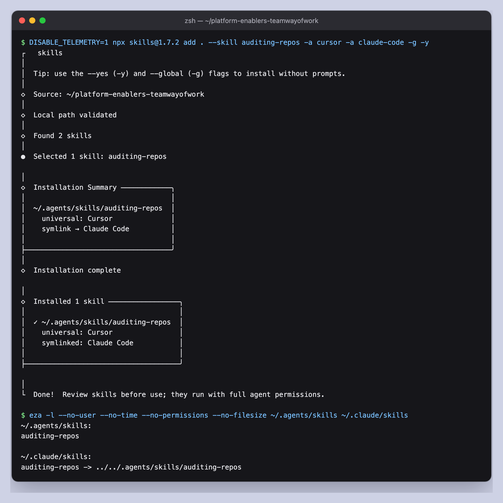
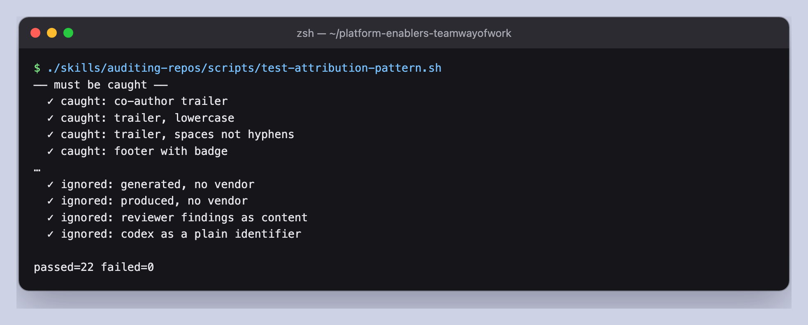
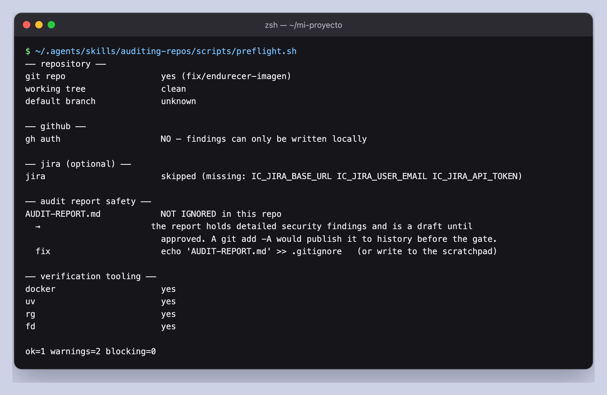
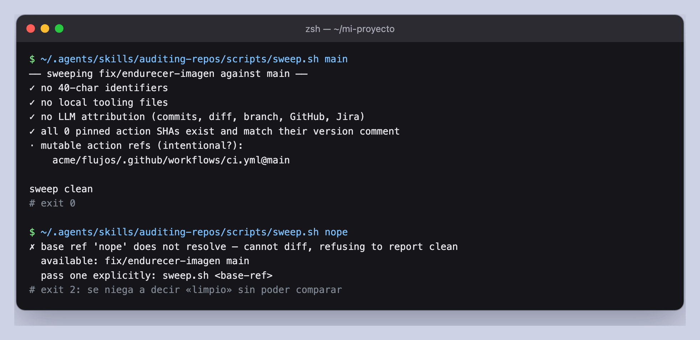

# Instalación detallada: comando por comando

> **¿Solo vas a usarla desde Cursor?** Tenés la [instalación simple](instalacion.md), que usa solo prompts. Esta guía es
> para quien quiere ver (o correr) cada comando, o instalarla sin un agente.

| Paso | Qué hacés |
|---|---|
| [1. Requisitos](#1-requisitos) | Comprobar `git`, `gh` y las herramientas opcionales |
| [2. Instalar](#2-instalar) | Clonar y enlazar, o `npx skills add` |
| [3. Comprobar la instalación](#3-comprobar-la-instalación) | Correr el test del detector de atribución |
| [4. Credenciales de Jira](#4-credenciales-de-jira) | Tres variables, opcionales |
| [5. Primera corrida](#5-primera-corrida) | `preflight.sh`, `sweep.sh`, `check-attribution.sh` |

> **Sobre las capturas.** Las terminales salen de ejecutar los scripts de este repo sobre un repo de prueba
> (`~/mi-proyecto`), con `GH_CONFIG_DIR` apuntando a una carpeta vacía (así `gh` figura sin autenticar) y sin variables
> de Jira: no tocan GitHub ni Jira. Las rutas están acortadas. La captura de `npx skills add` es la salida real del CLI en un `HOME` falso.

---

## 1. Requisitos

| Qué | Para qué | Sin esto |
|---|---|---|
| `git` | Todo | No corre |
| `gh` autenticado | Publicar issues y PRs; revisar PRs, issues y comentarios en el chequeo de atribución | Solo escribe el informe local |
| `docker` | Afirmar algo sobre la imagen construida | No podés afirmar nada sobre la imagen: hay que decirlo |
| `uv` | Resolver rangos de dependencias en sus extremos | No podés comprobar los rangos |
| `rg`, `fd` | Los sweeps | Quedan cortos |
| Variables `JIRA_*` | Jira | Se saltea Jira |

Los scripts usan `rg` (ripgrep): `sweep.sh` y `check-attribution.sh` lo llaman directo.

## 2. Instalar

```bash
git clone git@github.com:josefigueredo/teamwayofwork.git && cd teamwayofwork
mkdir -p ~/.agents/skills ~/.claude/skills
ln -s "$PWD/skills/auditing-repos" ~/.agents/skills/auditing-repos        # Codex, Copilot CLI, Cursor, Gemini CLI
ln -s ../../.agents/skills/auditing-repos ~/.claude/skills/auditing-repos  # además, para Claude Code
```

Se enlaza y no se copia: una sola fuente de verdad. `ln -s` falla si el destino ya existe; en ese caso verificá con
`ls -l ~/.agents/skills/auditing-repos` que apunte a tu clon.

### Instalar solo la skill con `npx skills add`

Alternativa al `ln -s`: el CLI [`skills`](https://github.com/vercel-labs/skills) instala **solo la carpeta de esta skill**
(la que cumple la [especificación de Agent Skills](https://agentskills.io/specification)), sin que enlaces nada a mano.
Necesita Node (`npx`) y el clon del repo; se corre desde la raíz del clon:

```bash
DISABLE_TELEMETRY=1 npx skills@1.7.2 add . --skill auditing-repos -a cursor -a claude-code -g -y
```



Lo que se comprobó corriéndolo con la versión 1.7.2, un `HOME` falso y la ruta del clon como fuente:

| Qué | Resultado |
|---|---|
| Descubrimiento | `--list` encuentra `auditing-repos` y `local-board-skill` en `skills/<nombre>/`; no lista nada más del repo |
| Dónde queda | Una **copia** en `~/.agents/skills/auditing-repos` (la lee Cursor) y un enlace `~/.claude/skills/auditing-repos -> ../../.agents/skills/auditing-repos` para Claude Code. Con `--copy` el enlace pasa a ser otra copia |
| Qué se copia | La carpeta completa de la skill (`SKILL.md`, `references/`, `scripts/`, `docs/`), idéntica al original y con los scripts ejecutables |
| Funciona desde ahí | `preflight.sh`, `sweep.sh`, `test-attribution-pattern.sh` y `test-sweep-pinned-shas.sh` corren desde la copia instalada y dan lo mismo que desde el clon (`sweep.sh` con un `gh` falso); las rutas del `SKILL.md` (`~/.agents/skills/auditing-repos/scripts/…` y `references/…`) resuelven |

Límites, para que no te sorprendan:

- **No se actualiza con `git pull`.** Lo instalado es una copia: después de traer cambios al clon, repetí el mismo comando.
  `npx skills update` no la revisa: con una fuente local dice `cannot be checked automatically (Local path)` y te indica volver a
  correr `add`.
- **Si ya la enlazaste a mano, `add` te reemplaza el enlace por una copia** (el clon no se toca, pero deja de ser la fuente
  de verdad). Si preferís seguir con `ln -s`, no corras este comando.
- `DISABLE_TELEMETRY=1` apaga la telemetría anónima del CLI, según su [README](https://github.com/vercel-labs/skills#telemetry).
- Usá siempre una versión fija (`skills@1.7.2`): lo descrito arriba es lo que se vio en esa versión.
- No se probó la fuente remota privada (`git@github.com:josefigueredo/…`), solo la ruta local; por eso el comando usa el clon.

> **Las skills de `harness/` (`jtk`, `wow`, `arq`, `pbmcp`, `ric`) no se instalan así.** Cada repo trae un `install.sh` que además
> deja un CLI en `~/.local/bin`, registra un servidor MCP o instala un hook, y `skills add` solo cubre carpetas de skills.
> Sus guías explican el camino correcto.

## 3. Comprobar la instalación

```bash
./skills/auditing-repos/scripts/test-attribution-pattern.sh
```



Prueba que el detector de atribución **dispara** en los casos malos y **no da falsos positivos** en los legítimos.

## 4. Credenciales de Jira

Opcionales. Siempre desde el entorno, nunca escritas en un archivo del repo:

```bash
export JIRA_BASE_URL=https://tu-empresa.atlassian.net
export JIRA_EMAIL=vos@tu-empresa.com
export JIRA_API_TOKEN=...          # https://id.atlassian.com/manage-profile/security/api-tokens
export JIRA_PROJECT_KEY=PLATE      # opcional: solo se consultan tickets de este proyecto
```

> Son los mismos nombres que usan `local-board-skill` y `jira-team-kit`, así que una sola configuración del shell sirve para las tres.
> La [referencia](referencia.md#requisitos) explica qué otras variables de Jira ignora a propósito.

El token se crea sin alcance, porque los scripts llaman a `<tu-sitio>.atlassian.net` con auth básica (`curl -u email:token`).
Un 401 en `/myself` significa token vencido o revocado, **no** falta de permisos: nunca concluyas «el ticket no existe»
mientras eso pase.

## 5. Primera corrida

Siempre **parado en el repo que auditás**, no en este.

```bash
export SKILL=~/.agents/skills/auditing-repos
$SKILL/scripts/preflight.sh
```



Sale con código 0 aunque falte algo opcional (cambia lo que podés *afirmar*, no si corre); solo sale con 1 si falta lo
bloqueante: que no sea un repo git o que no tenga commits. Después:

```bash
$SKILL/scripts/sweep.sh main          # 40 chars, tooling local, atribución, SHAs de actions, refs mutables
```



Un detalle que se ve en la captura: con cero actions fijadas por SHA, el sweep imprime `· no pinned action SHAs to verify`
(con un `·`, no con un `✓`): no había nada que chequear. Con una o más, sigue diciendo `✓ all N pinned action SHAs exist…`.

```bash
$SKILL/scripts/check-attribution.sh main
```


Cada superficie que no se pudo leer figura como **salteada** (`·`) o como falla (`✗`), nunca como limpia: por eso la última
línea dice «no attribution found on any reachable surface» y no «sin atribución».

## Códigos de salida

| Script | 0 | 1 | 2 |
|---|---|---|---|
| `sweep.sh` | limpio | encontró problemas | sin commits o la rama base no resuelve |
| `check-attribution.sh` | nada encontrado en las superficies alcanzables | encontró atribución o no pudo leer una superficie | la rama base no resuelve |
| `preflight.sh` | nada bloqueante (los faltantes opcionales solo avisan) | no es un repo git, o no tiene commits | — |
