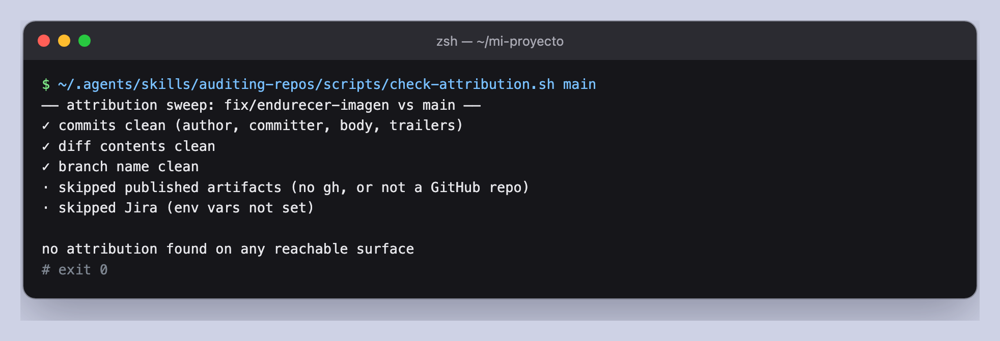

# Instalación detallada: comando por comando

> **¿Solo vas a usarla desde Cursor?** Tenés la [instalación simple](instalacion.md), que usa solo prompts. Esta guía es
> para quien quiere ver (o correr) cada comando, o instalarla sin un agente.

| Paso | Qué hacés |
|---|---|
| [1. Requisitos](#1-requisitos) | Comprobar `git`, `gh` y las herramientas opcionales |
| [2. Instalar](#2-instalar) | Clonar y enlazar |
| [3. Comprobar la instalación](#3-comprobar-la-instalación) | Correr el test del detector de atribución |
| [4. Credenciales de Jira](#4-credenciales-de-jira) | Tres variables, opcionales |
| [5. Primera corrida](#5-primera-corrida) | `preflight.sh`, `sweep.sh`, `check-attribution.sh` |

> **Sobre las capturas.** Las terminales salen de ejecutar los scripts de este repo sobre un repo de prueba
> (`~/mi-proyecto`), con `GH_CONFIG_DIR` apuntando a una carpeta vacía (así `gh` figura sin autenticar) y sin variables
> de Jira: no tocan GitHub ni Jira. Las rutas están acortadas.

---

## 1. Requisitos

| Qué | Para qué | Sin esto |
|---|---|---|
| `git` | Todo | No corre |
| `gh` autenticado | Publicar issues y PRs; revisar PRs, issues y comentarios en el chequeo de atribución | Solo escribe el informe local |
| `docker` | Afirmar algo sobre la imagen construida | No podés afirmar nada sobre la imagen: hay que decirlo |
| `uv` | Resolver rangos de dependencias en sus extremos | No podés comprobar los rangos |
| `rg`, `fd` | Los sweeps | Quedan cortos |
| Variables `IC_JIRA_*` | Jira | Se saltea Jira |

Los scripts usan `rg` (ripgrep): `sweep.sh` y `check-attribution.sh` lo llaman directo.

## 2. Instalar

```bash
git clone git@github.com:josefigueredo/teamwayofwork.git && cd teamwayofwork
mkdir -p ~/.agents/skills ~/.claude/skills
ln -s "$PWD/skills/auditing-repos" ~/.agents/skills/auditing-repos        # Codex, Copilot CLI, Cursor, Gemini CLI
ln -s ../../.agents/skills/auditing-repos ~/.claude/skills/auditing-repos  # además, para Claude Code
```

Se enlaza y no se copia: una sola fuente de verdad. `ln -s` falla si el destino ya existe; en ese caso verificá con
`ls -l ~/.agents/skills/auditing-repos` que apunte a tu clon.

## 3. Comprobar la instalación

```bash
./skills/auditing-repos/scripts/test-attribution-pattern.sh
```


Prueba que el detector de atribución **dispara** en los casos malos y **no da falsos positivos** en los legítimos.

## 4. Credenciales de Jira

Opcionales. Siempre desde el entorno, nunca escritas en un archivo del repo:

```bash
export IC_JIRA_BASE_URL=https://tu-empresa.atlassian.net
export IC_JIRA_USER_EMAIL=vos@tu-empresa.com
export IC_JIRA_API_TOKEN=...          # https://id.atlassian.com/manage-profile/security/api-tokens
export IC_JIRA_PROJECT_KEY=PLATE      # opcional: solo se consultan tickets de este proyecto
```

> Estos scripts solo leen los nombres `IC_JIRA_*`; no aceptan los genéricos `JIRA_*`. La [referencia](referencia.md#requisitos)
> explica qué otras variables `IC_JIRA_*` ignora a propósito.

El token se crea sin alcance, porque los scripts llaman a `<tu-sitio>.atlassian.net` con auth básica (`curl -u email:token`).
Un 401 en `/myself` significa token vencido o revocado, **no** falta de permisos: nunca concluyas «el ticket no existe»
mientras eso pase.

## 5. Primera corrida

Siempre **parado en el repo que auditás**, no en este.

```bash
export SKILL=~/.agents/skills/auditing-repos
$SKILL/scripts/preflight.sh
```


Sale con código 0 aunque falte algo opcional (cambia lo que podés *afirmar*, no si corre); solo sale con 1 si falta lo
bloqueante: que no sea un repo git o que no tenga commits. Después:

```bash
$SKILL/scripts/sweep.sh main          # 40 chars, tooling local, atribución, SHAs de actions, refs mutables
```


Un detalle que se ve en la captura: con cero actions fijadas por SHA, el sweep imprime `· no pinned action SHAs to verify`
(con un `·`, no con un `✓`): no había nada que chequear. Con una o más, sigue diciendo `✓ all N pinned action SHAs exist…`.

```bash
$SKILL/scripts/check-attribution.sh main
```



Cada superficie que no se pudo leer figura como **salteada** (`·`) o como falla (`✗`), nunca como limpia: por eso la última
línea dice «no attribution found on any reachable surface» y no «sin atribución».

## Códigos de salida

| Script | 0 | 1 | 2 |
|---|---|---|---|
| `sweep.sh` | limpio | encontró problemas | sin commits o la rama base no resuelve |
| `check-attribution.sh` | nada encontrado en las superficies alcanzables | encontró atribución o no pudo leer una superficie | la rama base no resuelve |
| `preflight.sh` | nada bloqueante (los faltantes opcionales solo avisan) | no es un repo git, o no tiene commits | — |
