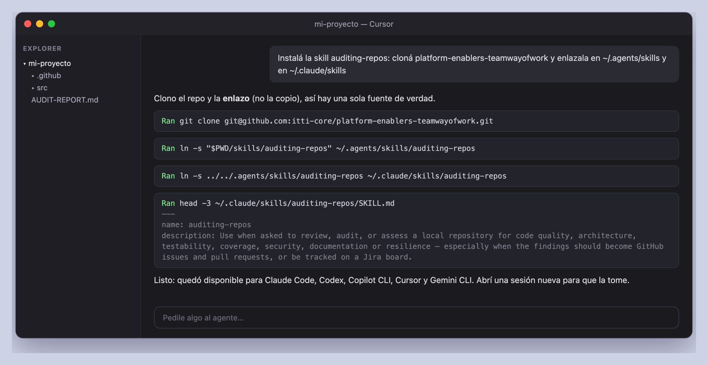
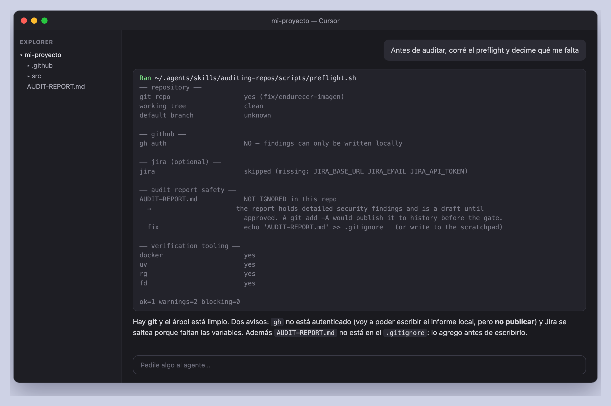
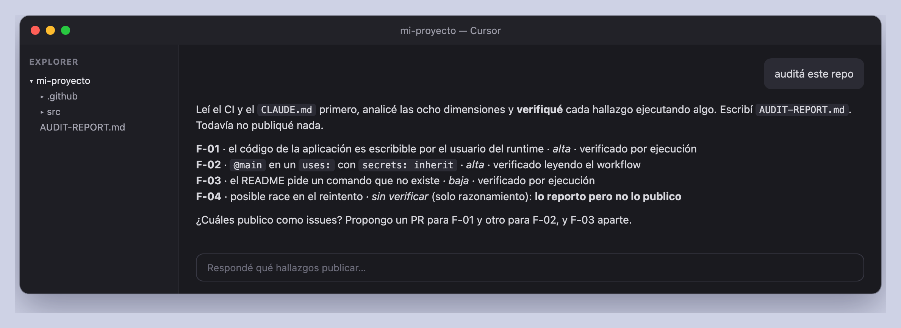
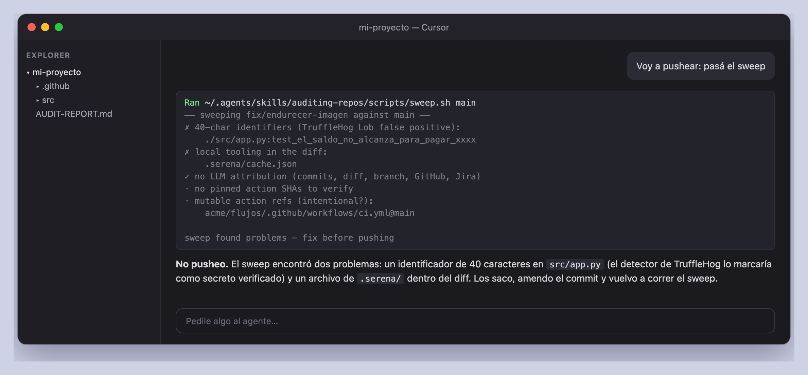

# Instalación y primer uso, desde Cursor

Todo esto se hace conversando con el agente de Cursor: le pedís las cosas y él corre los scripts por vos. Tres cosas **no**
son un prompt, y es a propósito:

- **Autenticar `gh`** (`gh auth login`) es un flujo interactivo con tu cuenta de GitHub: lo hacés vos en una terminal.
- **Las credenciales de Jira** son un secreto: las guardás vos en tu `~/.zshrc` y nunca las pegues en el chat.
- **Qué hallazgos se publican** lo decidís vos respondiendo en el chat. Es una decisión humana, pero ojo: la compuerta es
  una instrucción de la skill, no un bloqueo técnico (ver los [límites](showcase.md#qué-protege-y-qué-no)).

> ¿Preferís ver (o correr) cada comando? Está la [instalación detallada](instalacion-detallada.md). Para ver todo lo que
> hace la skill, el [showcase](showcase.md).

| Paso | Qué hacés | Cómo |
|---|---|---|
| [1. Instalar](#1-instalar) | Dejar la skill disponible en tus agentes | Un prompt |
| [2. GitHub y Jira](#2-github-y-jira) | Autenticar `gh` y, si querés Jira, guardar tres variables | Manual |
| [3. Primer uso: preflight](#3-primer-uso-preflight) | Ver qué hay y qué falta | Un prompt |
| [4. Tu primera auditoría](#4-tu-primera-auditoría) | Auditar, leer el informe y decidir qué publicar | Prompts |
| [5. Antes de pushear](#5-antes-de-pushear) | Pasar el sweep | Un prompt |
| [6. Mantenerla al día](#6-mantenerla-al-día) | Traer la versión nueva | Un prompt |

> **Sobre las capturas.** Son **maquetas** de Cursor: muestran cómo se ve la conversación, no una sesión grabada, y el texto
> del agente es ilustrativo. Los bloques `Ran` reproducen la salida **real** de esos comandos, corridos sobre un repo de
> prueba y con un `HOME` falso; la auditoría del paso 4 es una maqueta entera, con hallazgos ficticios, porque una auditoría
> real depende de tu repo y usa `gh`, Docker y Jira. [Tabla con el origen de cada imagen](#de-dónde-sale-cada-captura).

---

## 1. Instalar

Necesitás `git` y acceso por SSH al repo `josefigueredo/teamwayofwork`. Abrí cualquier carpeta en Cursor y
pedile:

> Instalá la skill auditing-repos: cloná teamwayofwork y enlazala en ~/.agents/skills y en ~/.claude/skills



*El bloque `head` es la salida real, leyendo el `SKILL.md` a través de los enlaces que se crearon en un `HOME` falso; los
`ln -s` no imprimen nada y el `git clone` no se corrió.*

Qué pasó:

- **Se enlazó, no se copió**: hay una sola fuente de verdad, tu clon. Si lo actualizás, la skill se actualiza.
- `~/.agents/skills/` lo leen Codex, Copilot CLI, GitHub Copilot en VS Code, Cursor y Gemini CLI. Para **Claude Code**
  hace falta además el segundo enlace, en `~/.claude/skills/`.
- Abrí una sesión nueva del agente para que la skill aparezca.

## 2. GitHub y Jira

Esto lo hacés vos, en una terminal.

**a) `gh`.** Sin `gh` autenticado la skill solo escribe el informe local: no publica. Corré `gh auth login` y seguí los pasos.

**b) Jira (opcional).** Si querés que la skill comente en tickets y revise sus comentarios, guardá tres variables en tu
`~/.zshrc`, con un editor, no por el chat. Son las únicas que leen los scripts, y son las mismas que usan las otras skills de Jira:

```bash
export JIRA_BASE_URL="https://tu-empresa.atlassian.net"
export JIRA_EMAIL="vos@tu-empresa.com"
export JIRA_API_TOKEN="el-token-que-creaste"   # https://id.atlassian.com/manage-profile/security/api-tokens
```

Opcionalmente `JIRA_PROJECT_KEY` (por ejemplo `PLATE`) para que solo se consulten tickets de tu proyecto. Después cerrá
Cursor del todo y abrilo de nuevo. Si falta alguna, Jira se saltea y **el resto de la skill funciona igual**.

## 3. Primer uso: preflight

Parado en el repo que querés auditar, pedile:

> Antes de auditar, corré el preflight y decime qué me falta



*El bloque `Ran` es la salida real (repo de prueba, sin `gh` autenticado ni variables de Jira).*

El preflight no escribe nada: informa git, permisos de `gh`, Jira, si `AUDIT-REPORT.md` está ignorado y qué herramientas hay.
Un aviso como el de la captura (`NOT IGNORED`) importa: el informe tiene hallazgos de seguridad y un `git add -A` lo subiría
antes de la aprobación.

## 4. Tu primera auditoría

> auditá este repo



*Maqueta completa con hallazgos ficticios: no hay salida de herramientas.*

El agente hace seis cosas, en este orden, y **hasta la quinta no publica nada**:

1. **Preflight** y lectura del CI y de `CLAUDE.md`/`AGENTS.md` antes de analizar.
2. **Analiza** ocho dimensiones: código limpio, arquitectura, testabilidad, cobertura, seguridad, cadena de suministro,
   resiliencia y documentación.
3. **Verifica**: construye, ejecuta, resuelve, hace fallar cada guardia. Un hallazgo sin ejecución queda como
   `unverified` y **no se publica**.
4. **Escribe `AUDIT-REPORT.md`** con evidencia y confianza por hallazgo.
5. **Frena y te pregunta** cuáles publicar. Respondele en el chat, por ejemplo: *«publicá F-01 y F-02, F-03 no»*.
6. **Publica** un issue por hallazgo y PRs agrupados, y después responde la review de los revisores automáticos.

## 5. Antes de pushear

> Voy a pushear: pasá el sweep y chequeá que nada indique que lo hizo un LLM



*El bloque `Ran` es salida real del sweep sobre un repo de prueba preparado para fallar.*

Si el sweep dice `sweep clean`, seguí. Si encuentra problemas, que el agente los arregle y lo vuelva a correr. Si la rama base
no resuelve, el sweep **se niega a decir «limpio»** y sale con código 2.

## 6. Mantenerla al día

Como se enlazó, alcanza con traer lo nuevo del clon:

> Actualizá mi clon de teamwayofwork con lo último de main

---

## Si algo falla

| Síntoma | Causa probable | Qué hacer |
|---|---|---|
| El agente no ofrece la skill | Se abrió la sesión antes de crear los enlaces | Abrí una sesión nueva; verificá que `~/.agents/skills/auditing-repos` apunte a tu clon |
| Funciona en Cursor pero no en Claude Code | Falta el enlace de `~/.claude/skills/` | Pedile al agente el segundo `ln -s` del paso 1 |
| `gh auth NO` en el preflight | `gh` no está autenticado | `gh auth login` (paso 2); mientras tanto solo hay informe local |
| `jira skipped (missing: …)` | Faltan variables `JIRA_*` | Paso 2b; o ignoralo si no usás Jira |
| `jira auth HTTP 401` | Token vencido o revocado (no es un problema de permisos) | Creá otro token y cambiá `JIRA_API_TOKEN` |
| `base ref '…' does not resolve` (código 2) | El sweep no encuentra la rama base | Pasala explícita: `sweep.sh <rama-base>` |

## De dónde sale cada captura

| Imagen | Origen |
|---|---|
| `cursor-instalar.png` | Maqueta; el `head` es la salida real a través de enlaces creados en un `HOME` falso |
| `cursor-preflight.png` | Maqueta; el bloque `Ran` es la salida real de `preflight.sh` |
| `cursor-auditoria.png` | Maqueta completa, hallazgos ficticios |
| `cursor-sweep.png` | Maqueta; el bloque `Ran` es la salida real de `sweep.sh` |

Los HTML de origen están en [`img/src/`](img/src/).
