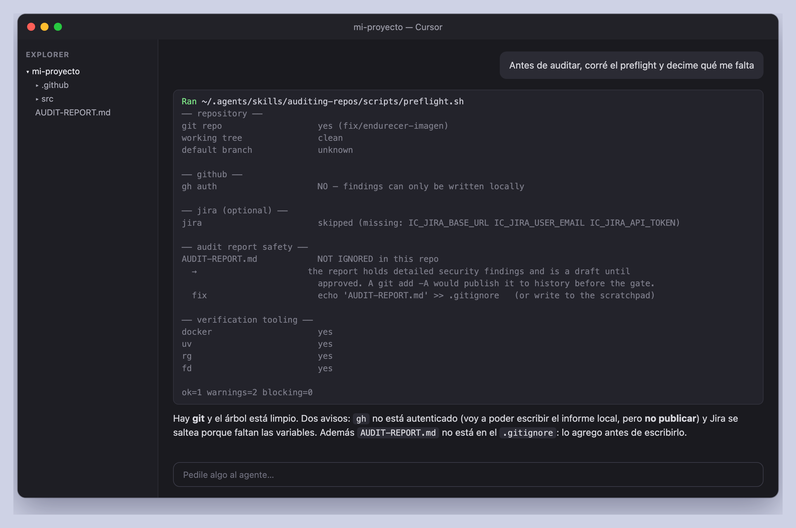
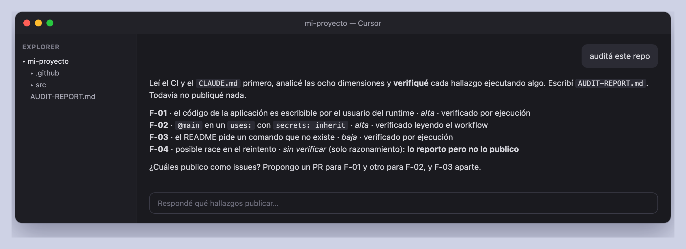
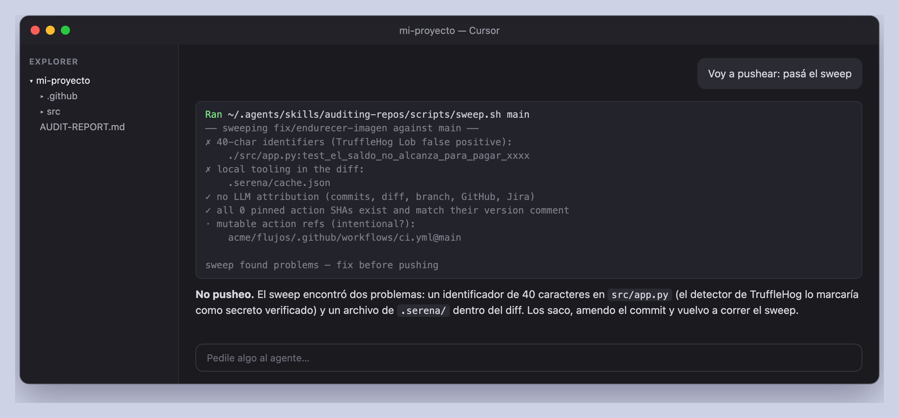
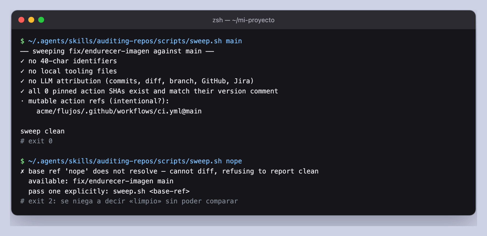
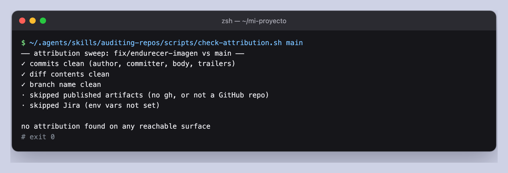

# Showcase

Qué se puede hacer con `auditing-repos`, escenario por escenario: qué le decís al agente, qué corre por detrás y qué ves. Para
instalarla, la [guía con prompts de Cursor](instalacion.md) o la [detallada](instalacion-detallada.md); para el detalle de cada
regla, la [referencia](referencia.md).

| Pieza | Escenario | Ir al caso |
|---|---|---|
| `preflight.sh` | «¿Qué me falta para auditar?» | [Preflight](#1-qué-hay-y-qué-falta-antes-de-empezar) |
| la skill | «Auditá este repo» | [Auditar y frenar en la compuerta](#2-auditar-un-repo-y-frenar-en-la-compuerta) |
| `sweep.sh` | «Voy a pushear» | [El sweep](#3-el-sweep-antes-de-pushear) |
| `check-attribution.sh` | Que nada indique que lo hizo un LLM | [Atribución](#4-que-nada-indique-que-lo-hizo-un-llm) |
| la skill | «Vinculá los PRs al ticket» y «contestá la review» | [Jira y review](#5-vincular-a-jira-y-responder-la-review) |

> **Sobre las salidas.** Los casos 1, 3 y 4 muestran salida **real** de los scripts sobre un repo de prueba, sin `gh` autenticado
> y sin Jira. Los casos 2 y 5 hacen cosas que dependen de tu repo, de GitHub, de Docker y de Jira: ahí la conversación es una
> **maqueta con datos ficticios**, sin salida de herramientas inventada.

---

## Lo que la distingue

| | |
|---|---|
| **Un hallazgo sin verificar no es un hallazgo** | Cada afirmación del informe sale de ejecutar algo; lo que es solo razonamiento se reporta pero no se publica |
| **Compuerta antes de publicar** | La skill frena con el informe y espera tu respuesta antes de tocar GitHub o Jira |
| **Un issue por hallazgo, PRs agrupados** | El triage es individual; los PRs agrupan cambios independientemente mergeables |
| **Un chequeo que no pudo correr no aprueba** | Sin rama base, sin lectura de una superficie o con un token muerto, el script falla o avisa: no dice «limpio» |
| **Nada indica que lo hizo un LLM** | Regla absoluta, con un detector que se prueba en las dos direcciones |

---

## 1. Qué hay y qué falta antes de empezar

**Pieza:** `preflight.sh` · **Escribe:** no.

*Maqueta de la conversación; el bloque `Ran` es salida real.*

Un faltante opcional no frena la auditoría: cambia lo que podés **afirmar**. Sin `docker`, por ejemplo, el agente tiene que
decir que no pudo comprobar nada sobre la imagen, en vez de inferirlo. Y el aviso sobre `AUDIT-REPORT.md` evita que un
`git add -A` suba el borrador con hallazgos de seguridad antes de la aprobación.

**Si falla:** fuera de un repo git, o en uno sin commits, el preflight lo marca como bloqueante y sale con código 1.

## 2. Auditar un repo y frenar en la compuerta

**Pieza:** la skill · **Escribe en GitHub:** sí, solo después de tu respuesta.

*Maqueta completa con datos ficticios.*

El flujo es `preflight → analizar → VERIFICAR → informe local → APROBACIÓN → publicar → responder review`. El informe lleva, por
hallazgo, evidencia y una `Confidence`: `verified by execution`, `verified by docs` o `unverified — reasoning only`. En la
captura, F-04 está sin verificar: se **reporta pero no se publica**.

Al publicar, un issue por hallazgo y los PRs agrupados (cada PR abre con `Closes #a. Closes #b.` y nombra los archivos que
comparte con sus hermanos). El detalle está en la [referencia](referencia.md#el-flujo).

## 3. El sweep antes de pushear

**Pieza:** `sweep.sh` · **Escribe:** no.

Qué atrapa, de la [referencia](referencia.md#qué-atrapa-el-sweep): identificadores de 40 caracteres, tooling local en el diff,
atribución, SHAs de actions que no corresponden al tag de su comentario, y refs mutables (informativo).

Y cuando no puede comparar, no aprueba:

## 4. Que nada indique que lo hizo un LLM

**Pieza:** `check-attribution.sh` · **Escribe:** no.

Revisa metadatos de commits, líneas agregadas del diff, nombre de la rama y, si hay `gh` y credenciales, PRs, issues,
comentarios y comentarios de Jira. Lo que no puede leer figura como salteado (`·`) o como falla (`✗`), no como limpio.
El detector se prueba en las dos direcciones con `test-attribution-pattern.sh` (22 casos).

## 5. Vincular a Jira y responder la review

**Pieza:** la skill · **Escribe:** comentarios en tickets y en PRs, con tu aprobación. *Maqueta en texto, datos ficticios.*

> **Vos:** vinculá estos PRs al ticket PLATE-384
>
> **Agente (maqueta):** Jira vincula un PR cuando la clave está en el nombre de la rama, en un commit o en el título del PR. Los
> PRs #12 y #13 ya existen, así que **no renombro sus ramas** (GitHub cierra un PR si se renombra su rama *head*): les agrego
> la clave al final del título, `… (PLATE-384)`.

La regla de la rama y la forma del título vienen de la [referencia](referencia.md#vincular-a-jira). Para la review, la skill
verifica cada comentario del revisor automático antes de aceptarlo o rechazarlo, en las dos direcciones.

---

## Qué protege y qué no

| Te protege de… | Cómo |
|---|---|
| Publicar una suposición como si fuera un hallazgo | Todo hallazgo lleva su confianza; lo no verificado no se publica |
| Subir el informe o tooling local por accidente | El preflight avisa si `AUDIT-REPORT.md` no está ignorado; el sweep marca `.serena/`, `.idea/`, etc. |
| Un falso «limpio» | Rama base inexistente → código 2; superficie ilegible → salteada o fallida |
| Atribución a un LLM en el historial | `check-attribution.sh` mira commits, diff, rama, GitHub y Jira |

| **No** te protege de… | Por qué |
|---|---|
| Un agente que publique sin preguntar | La compuerta es una instrucción de `SKILL.md`; los scripts no publican ni bloquean un `gh issue create` |
| Un hallazgo verificado mal | Verificar es trabajo del agente y de quien lee el informe: revisalo antes de responder qué publicar |
| Atribución en superficies que no se leen | Solo se revisa lo que el script puede alcanzar; el resto figura como salteado |
| Jira con otros nombres de variable | Los scripts leen solo `IC_JIRA_*` |

**Cuando algo falla:** un script que no puede evaluar sale con código distinto de 0 o marca la superficie como salteada. Un 404
de Jira con un token muerto es un 401 disfrazado: el preflight distingue «token vencido» de «sin permisos».
