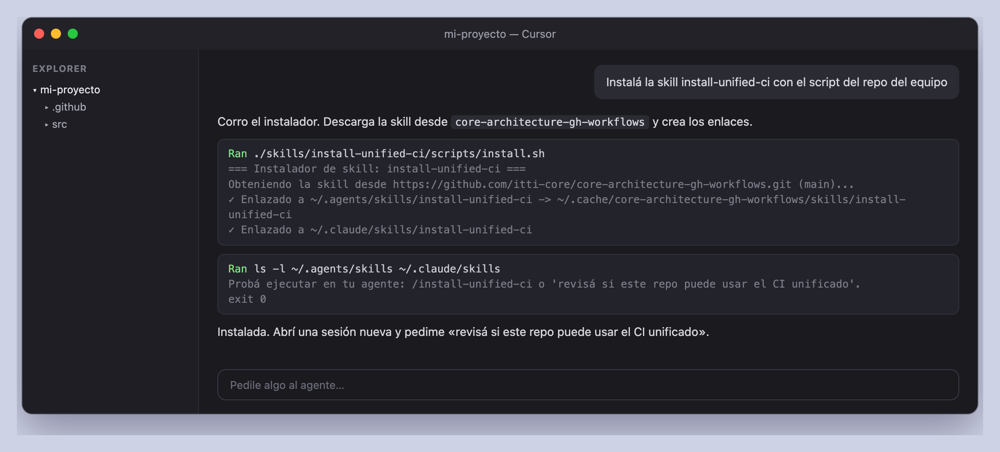

# install-unified-ci

> 🧪 **Fase: Incubation.** Esta skill vive canónicamente en [`core-architecture-gh-workflows`](https://github.com/josefigueredo/core-architecture-gh-workflows/tree/main/skills/install-unified-ci). Usala y reportá lo que encuentres; todavía no construyas encima. Ver el [ciclo de vida](../../README.md#ciclo-de-vida).

Este directorio **no contiene la skill**: contiene su instalador (`scripts/install.sh`) y esta documentación. La skill en sí
(`SKILL.md`, `references/`) vive en el repo `core-architecture-gh-workflows` y el instalador la trae de ahí. Para Claude Code,
Codex, Copilot CLI, Gemini CLI y OMP, esto es lo que le podés pedir al agente una vez instalada:

| Le decís al agente… | Y la skill… |
|---|---|
| *«Adoptá el CI unificado acá»*, *«migrá este repo a Unified CI»* | evalúa el repo, genera el `.github/workflows/ci.yml` canónico para su stack y poda los workflows viejos |
| *«Revisá si este repo puede usar el CI unificado»* | audita la compatibilidad y, si hay requerimientos incompatibles, **frena y reporta los gaps** en vez de romper el CI |
| *«Reemplazá los workflows viejos por el CI unificado»* | reemplaza los workflows de test, build, lint o Sonar propios por el flujo unificado |

Eso es lo que dice el README de la skill (en [la referencia](docs/referencia.md)); **este repo no incluye su `SKILL.md`, así
que no se verificó acá cómo se comporta**. Lo que sí se verificó es el instalador.

**Qué hace el instalador:** descarga la skill en `~/.cache/core-architecture-gh-workflows` y crea enlaces en
`~/.agents/skills/` y `~/.claude/skills/`. Antes de enlazar **borra** lo que haya en esos dos destinos: ver los
[límites](docs/showcase.md#qué-protege-y-qué-no).

## Elegí por dónde empezar

| Pieza | Qué resuelve | Escribe | Se instala con | Showcase | Instalación |
|---|---|---|---|---|---|
| **`scripts/install.sh`** | Traer la skill canónica y enlazarla en tus agentes | Tu `HOME` (cache y enlaces) | `./skills/install-unified-ci/scripts/install.sh` | [Ver el caso](docs/showcase.md#1-instalar-o-actualizar-la-skill) | [Instalar](docs/instalacion.md#1-instalar) |
| **La skill** (en `core-architecture-gh-workflows`) | Evaluar un repo y migrarlo al CI unificado | Archivos de **tu** repo, en tu rama | la instala el script de arriba | [Ver el caso](docs/showcase.md#2-pedirle-al-agente-que-evalúe-un-repo) | [Instalar](docs/instalacion.md#3-primer-uso) |

## Un ejemplo: el instalador

La salida del instalador es la del script real, corrido con un `HOME` falso y un `git` de prueba que no sale a la red; la
conversación es una maqueta.



## Qué documento leer

| Si querés… | Leé | Qué encontrás |
|---|---|---|
| **Instalarla y probarla, desde Cursor** | [Instalación y primer uso](docs/instalacion.md) | Todo con prompts: instalar, primer uso, actualizar |
| **Instalarla comando por comando** | [Instalación detallada](docs/instalacion-detallada.md) | Requisitos, qué hace `install.sh` línea por línea, la instalación manual y cómo verificarla |
| **Ver todo lo que hace** | [Showcase](docs/showcase.md) | Instalar, usarla, y qué protege y qué no |
| **Consultar un detalle** | [Referencia](docs/referencia.md) | El README de la skill: principio, cuándo usarla, arquitectura y stacks soportados |

## En tres comandos

```bash
git clone git@github.com:josefigueredo/teamwayofwork.git && cd teamwayofwork
./skills/install-unified-ci/scripts/install.sh                    # clona la skill en ~/.cache y la enlaza
ls -l ~/.agents/skills/install-unified-ci/SKILL.md                 # comprueba que quedó
```

Requisitos: `git` y que tu máquina pueda clonar `https://github.com/josefigueredo/core-architecture-gh-workflows.git` (el script
usa HTTPS y `set -e`: si el clon falla, corta sin enlazar nada). No se verificó si ese repo es público o privado.

## Desarrollo

```bash
python3 tests/test_docs_links.py     # los links de estos docs, desde la raíz del repo
```
