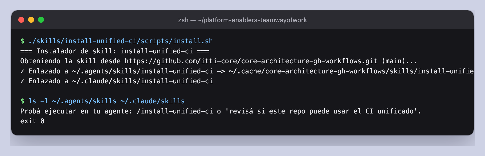

# Instalación detallada: comando por comando

> **¿Solo vas a usarla desde Cursor?** Tenés la [instalación simple](instalacion.md), que usa solo prompts. Esta guía es para
> quien quiere ver (o correr) cada comando.

| Paso | Qué hacés |
|---|---|
| [1. Requisitos](#1-requisitos) | `git` y acceso al repo canónico |
| [2. Instalar con el script](#2-instalar-con-el-script) | `./skills/install-unified-ci/scripts/install.sh` |
| [3. Qué hace el script, línea por línea](#3-qué-hace-el-script-línea-por-línea) | Para saber qué toca en tu `HOME` |
| [4. Instalación manual](#4-instalación-manual) | Si ya tenés clonado `core-architecture-gh-workflows` |
| [5. Verificar y actualizar](#5-verificar-y-actualizar) | Comprobar los enlaces y volver a correr |

> **Sobre las capturas.** La terminal sale de correr el `install.sh` real de este repo con un `HOME` falso y con un `git` de
> prueba (un script que anota sus argumentos y fabrica la carpeta de la skill) puesto primero en el `PATH`: **no hubo red ni
> descarga**. Lo que se ve es lo que el script imprime y los enlaces que crea; no se ve contenido descargado.

---

## 1. Requisitos

| Qué | Para qué |
|---|---|
| `git` | El script clona con `--sparse` y `--filter=blob:none` |
| Acceso HTTPS a `https://github.com/josefigueredo/core-architecture-gh-workflows.git` | Es de donde el script trae la skill. No se verificó si el repo es público o privado |
| `bash` | El script usa `set -euo pipefail` |

## 2. Instalar con el script

Desde tu clon de `teamwayofwork`:

```bash
./skills/install-unified-ci/scripts/install.sh
```



## 3. Qué hace el script, línea por línea

| Paso del script | Qué hace |
|---|---|
| Cache | Si `~/.cache/core-architecture-gh-workflows` no tiene `.git`: `git clone --depth 1 --branch main --filter=blob:none --sparse` y `sparse-checkout set skills/install-unified-ci` |
| Cache ya existente | `sparse-checkout set`, `fetch --depth 1 origin main` y **`reset --hard FETCH_HEAD`** (descarta cambios locales en la cache) |
| Validación | Si no existe `SKILL.md` en la carpeta descargada, sale con error **antes** de tocar enlaces |
| `~/.agents/skills/install-unified-ci` | **`rm -rf`** del destino y `ln -sfn` hacia la cache |
| `~/.claude/skills/install-unified-ci` | **`rm -rf`** del destino y enlace hacia `~/.agents/skills/install-unified-ci` |
| `~/.omp/skills/install-unified-ci` | Solo si existe `~/.omp/skills`: igual que arriba |
| Verificación | Comprueba que `~/.agents/skills/install-unified-ci/SKILL.md` exista y lo informa |

Es idempotente: correrlo de nuevo actualiza la cache y rehace los enlaces (en la prueba, la segunda corrida llegó al mismo mensaje
de éxito y ejecutó el camino `fetch` + `reset --hard`).

## 4. Instalación manual

Si ya tenés clonado `core-architecture-gh-workflows`:

```bash
ln -s "/ruta/a/core-architecture-gh-workflows/skills/install-unified-ci" ~/.agents/skills/install-unified-ci   # Codex, Copilot CLI, Gemini CLI, OMP
mkdir -p ~/.claude/skills
ln -s ../../.agents/skills/install-unified-ci ~/.claude/skills/install-unified-ci                                # Claude Code
```

`ln -s` falla si el destino ya existe (a diferencia del script, no borra nada).

## 5. Verificar y actualizar

```bash
ls -l ~/.agents/skills/install-unified-ci/SKILL.md
```

Para actualizar con el script, corrélo otra vez; con la instalación manual, hacé `git pull` en tu clon de
`core-architecture-gh-workflows`. Después abrí una sesión nueva del agente.
