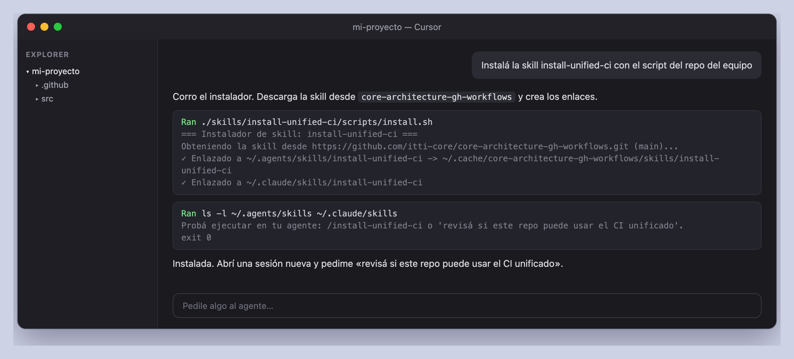
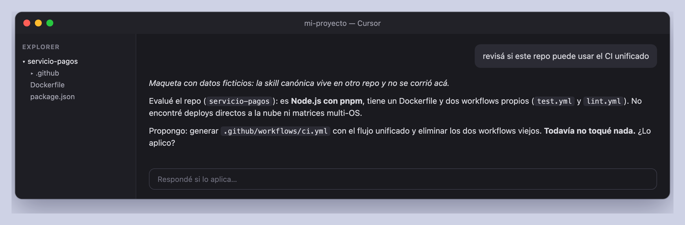

# Instalación y primer uso, desde Cursor

Todo esto se hace conversando con el agente de Cursor: le pedís que corra el instalador y después que use la skill. Una cosa
**no** es un prompt, y es a propósito:

- **Revisar y aprobar lo que la skill cambia en tu repo** (el `ci.yml` nuevo y los workflows que poda) lo hacés vos, mirando el
  diff antes de commitear. Pedile siempre que trabaje en una rama y que no pushee.

> ¿Preferís ver (o correr) cada comando? Está la [instalación detallada](instalacion-detallada.md). Para ver todo lo que hace
> la skill, el [showcase](showcase.md).

| Paso | Qué hacés | Cómo |
|---|---|---|
| [1. Instalar](#1-instalar) | Traer la skill canónica y enlazarla | Un prompt |
| [2. Comprobar](#2-comprobar) | Verificar que quedó y abrir una sesión nueva | Un prompt |
| [3. Primer uso](#3-primer-uso) | Pedirle que evalúe un repo | Un prompt + tu revisión |
| [4. Mantenerla al día](#4-mantenerla-al-día) | Volver a correr el instalador | Un prompt |

> **Sobre las capturas.** Son **maquetas** de Cursor, y el texto del agente es ilustrativo. El bloque `Ran` del paso 1 es la
> salida **real** de `install.sh`, corrido con un `HOME` falso y un `git` de prueba que no sale a la red (no se descargó nada). El
> paso 3 es una maqueta entera con datos ficticios: la skill canónica no vive en este repo y no se corrió.
> [Tabla con el origen de cada imagen](#de-dónde-sale-cada-captura).

---

## 1. Instalar

Necesitás `git` y poder clonar `core-architecture-gh-workflows` por HTTPS. Abrí tu clon de `teamwayofwork` en
Cursor y pedile:

> Instalá la skill install-unified-ci con el script del repo: ./skills/install-unified-ci/scripts/install.sh

*Los bloques `Ran` son salida real del script (git de prueba, `HOME` falso).*

Qué pasó:

- **Se descargó la skill** en `~/.cache/core-architecture-gh-workflows` (solo la carpeta `skills/install-unified-ci`, con
  sparse-checkout, siempre de la rama `main`).
- **Se enlazó** en `~/.agents/skills/install-unified-ci` (Codex, Copilot CLI, Gemini CLI) y en `~/.claude/skills/` (Claude Code).
  Si existe `~/.omp/skills`, también ahí.
- **Se borró lo que hubiera** en esos destinos antes de enlazar. Si tenías una copia propia con ese nombre, avisale al agente
  antes de correr el instalador.

## 2. Comprobar

> Comprobá que ~/.agents/skills/install-unified-ci/SKILL.md existe

Después abrí una sesión nueva del agente para que la tome.

## 3. Primer uso

En el repo que querés evaluar, en una rama nueva:

> revisá si este repo puede usar el CI unificado

*Maqueta con datos ficticios.*

Según el README de la skill, evalúa el repo, audita la compatibilidad, genera el `ci.yml` y poda lo obsoleto, y **frena y reporta
los gaps** si hay deploys directos a la nube, matrices multi-OS o migraciones de base de datos en el runner. Antes de aceptar
cualquier cambio, mirá el diff.

## 4. Mantenerla al día

El instalador siempre trae lo último de `main`: para actualizar, corrélo de nuevo.

> Volvé a correr ./skills/install-unified-ci/scripts/install.sh para actualizar la skill

---

## Si algo falla

| Síntoma | Causa probable | Qué hacer |
|---|---|---|
| El script termina sin el mensaje de «instalada correctamente» | Falló el clon o el `fetch` (el script usa `set -e`) | Revisá tu acceso a `core-architecture-gh-workflows` y corrélo de nuevo |
| `no se encontró un SKILL.md válido en …` | La carpeta descargada no trae `SKILL.md` | No se enlazó nada; revisá el repo canónico |
| El agente no ofrece la skill | Sesión abierta antes de instalar | Abrí una sesión nueva |
| Perdí una copia mía de la skill | El script borra los destinos antes de enlazar | Restauralas desde tu respaldo; ver los [límites](showcase.md#qué-protege-y-qué-no) |

## De dónde sale cada captura

| Imagen | Origen |
|---|---|
| `cursor-instalar.png` | Maqueta; los `Ran` son la salida real de `install.sh` con `HOME` falso y `git` de prueba (sin red) |
| `cursor-uso.png` | Maqueta completa, datos ficticios |

Los HTML de origen están en [`img/src/`](img/src/).
