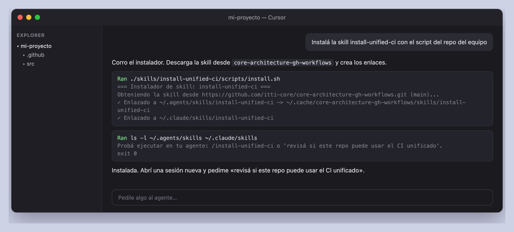
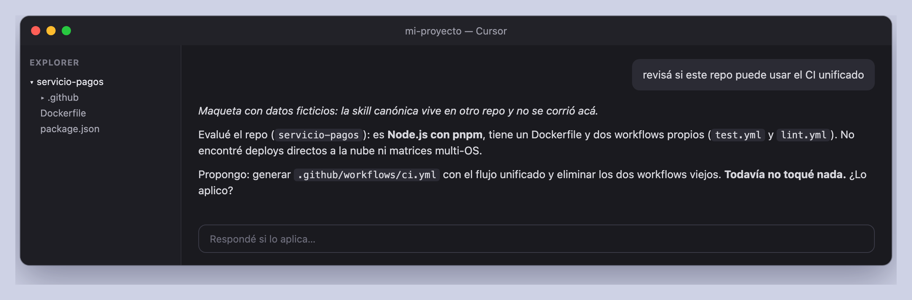

# Showcase

Qué se puede hacer con `install-unified-ci`. Esta skill tiene una particularidad: **la skill canónica vive en
`core-architecture-gh-workflows`**, y este repo solo trae su instalador. Por eso este showcase documenta con detalle lo que se
puede verificar acá (el instalador) y resume, sin afirmar más de lo que el README de la skill dice, el uso. Para instalarla, la
[guía con prompts de Cursor](instalacion.md) o la [detallada](instalacion-detallada.md); para el README de la skill, la
[referencia](referencia.md).

| Pieza | Escenario | Ir al caso |
|---|---|---|
| `scripts/install.sh` | «Instalá o actualizá la skill» | [Instalar o actualizar](#1-instalar-o-actualizar-la-skill) |
| la skill | «Revisá si este repo puede usar el CI unificado» | [Evaluar un repo](#2-pedirle-al-agente-que-evalúe-un-repo) |

> **Sobre las salidas.** El caso 1 muestra la salida **real** del instalador, con un `HOME` falso y un `git` de prueba (sin red).
> El caso 2 es una **maqueta con datos ficticios**: la skill canónica no está en este repo y no se corrió.

---

## 1. Instalar o actualizar la skill

**Pieza:** `scripts/install.sh` · **Escribe:** tu `HOME` (cache y enlaces), nada de tu repo.

*Maqueta de la conversación; los bloques `Ran` son la salida real del script con un `git` de prueba.*

### Qué corre el agente

| # | Comando | Para qué |
|---|---|---|
| 1 | `./skills/install-unified-ci/scripts/install.sh` | Traer la skill de `main` y enlazarla |
| 2 | `ls -l ~/.agents/skills ~/.claude/skills` | Ver los enlaces |

Es el mismo comando para instalar y para actualizar: si la cache existe, hace `fetch` y `reset --hard`.

## 2. Pedirle al agente que evalúe un repo

**Pieza:** la skill · **Escribe:** archivos de tu repo (`ci.yml` y la poda de workflows), según su README.

*Maqueta con datos ficticios.*

Según el README de la skill:

- Se activa con frases como «adoptá el CI unificado», «migrá este repo a Unified CI» o «revisá si este repo puede usar el CI
  unificado»; también con `/install-unified-ci`.
- Si el repo tiene requerimientos incompatibles (deploys directos a AWS ECS/Lambda o GCP, matrices multi-OS, migraciones de
  base de datos directas en el runner), **frena y reporta los gaps**.
- Sigue cinco pasos: evaluación, auditoría, generación, poda y reporte.

Lo demás (qué stacks soporta, qué plantillas YAML usa) está en la [referencia](referencia.md#stacks-soportados) y se mantiene en
el repo canónico: **no se verificó acá**.

---

## Qué protege y qué no

| Te protege de… | Cómo |
|---|---|
| Enlazar una carpeta rota | Si la descarga no trae `SKILL.md`, el script sale con error antes de tocar los enlaces |
| Una instalación a medias | `set -euo pipefail`: si el clon o el `fetch` fallan, el script corta |
| Duplicar tu fuente de verdad | Instala enlaces a una sola cache; no copia la skill |

| **No** te protege de… | Por qué |
|---|---|
| Perder algo tuyo en los destinos | El script hace `rm -rf` de `~/.agents/skills/install-unified-ci` y de `~/.claude/skills/install-unified-ci` (y de `~/.omp/skills/install-unified-ci` si existe `~/.omp/skills`) antes de enlazar |
| Perder cambios locales en la cache | En una cache existente hace `reset --hard FETCH_HEAD` |
| Una skill que cambie sin aviso | Siempre baja la rama `main` del repo canónico; no fija una versión |
| Un cambio no deseado en tu repo | Aceptar el `ci.yml` y la poda es decisión tuya: pedile una rama aparte y revisá el diff |

**Cuando algo falla:** con un clon o `fetch` fallido el script termina con error y sin el mensaje de éxito; con una carpeta sin
`SKILL.md`, imprime `no se encontró un SKILL.md válido` y sale con código 1.
