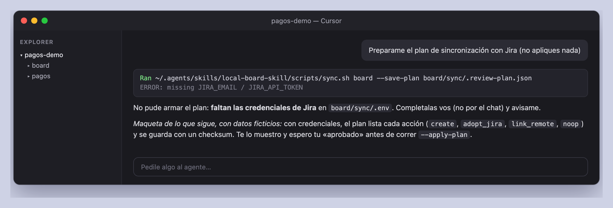

# local-board-skill

> 🚧 **Fase: Beta.** Se usa de verdad, todavía se ajusta con el uso. Apoyate y avisá si rompe. Ver el [ciclo de vida](../../README.md#ciclo-de-vida).

Una skill para mantener un board de trabajo en archivos Markdown (épicas, historias, tareas y subtareas), trazado contra la
evidencia de Git, y sincronizarlo con Jira solo después de revisar un plan. Cada cosa que le pedís al agente tiene su respuesta:

| Le decís al agente… | Y la skill… |
|---|---|
| *«Armame un board local para este proyecto»* | crea la estructura (`Board.md`, `_meta/`, `sync/`) y la jerarquía épica → historia → tarea → subtarea |
| *«¿Qué commits hay desde el último sync?»* | inventaría los repos desde la fecha de corte y lee cada diff, no solo el título |
| *«Relacioná estos commits y specs con las tareas»*, *«reconciliá la evidencia histórica»* | arma el grafo de relaciones, lo valida y rechaza nodos sueltos antes de llegar a Jira |
| *«Preparame el plan de sync con Jira»* | genera un plan (dry run) con un checksum, sin escribir en Jira |
| *«Aplicá el plan que aprobé»* | verifica el plan guardado y el grafo, y recién ahí escribe en Jira |
| *«Limpiá los links remotos con `.git`»* | primero lista los links remotos mal formados que borraría; borra solo si se lo pedís con `--apply` |

**Lo que escribe en Jira es solo `--apply-plan` y la limpieza de links con `--apply`**; todo lo demás es local. La aprobación es una
práctica de la skill (guardar el plan, revisarlo, aplicar ese mismo plan), no una ventana ni un bloqueo: el [showcase](docs/showcase.md#qué-protege-y-qué-no)
explica los límites.

## Elegí por dónde empezar

| Pieza | Qué resuelve | Jira | Se instala con | Showcase | Instalación |
|---|---|---|---|---|---|
| **`init_board.py` + `create_asset.py`** | Armar el board y la jerarquía | No | `ln -s` a `~/.agents/skills` (y a `~/.claude/skills`) | [Ver el caso](docs/showcase.md#1-armar-un-board-local) | [Instalar](docs/instalacion.md#1-instalar) |
| **`inventory_git.py` y el grafo** | Evidencia de Git, relaciones y validación | No | viene con la skill | [Ver el caso](docs/showcase.md#2-relacionar-commits-con-el-board) | [Instalar](docs/instalacion.md#4-evidencia-de-git) |
| **`sync.sh --save-plan`** | Plan de sincronización (dry run) | Lee, necesita credenciales | viene con la skill | [Ver el caso](docs/showcase.md#3-preparar-el-plan-de-sync) | [Instalar](docs/instalacion.md#2-credenciales-de-jira) |
| **`sync.sh --apply-plan`** | Aplicar el plan aprobado | Escribe | viene con la skill | [Ver el caso](docs/showcase.md#4-aplicar-el-plan-aprobado) | [Instalar](docs/instalacion.md#5-plan-de-sync-y-aprobación) |
| **`purge_bad_remote_links.py`** | Quitar links remotos con `.git` | Lee; borra solo con `--apply` | viene con la skill | [Ver el caso](docs/showcase.md#5-limpiar-links-remotos-mal-formados) | [Instalar](docs/instalacion.md#2-credenciales-de-jira) |

## Un ejemplo: preparar el plan sin credenciales

Sin credenciales, `--save-plan` no llega a Jira: corta con un error claro y no escribe nada. La salida es real, corrida sobre
un board de prueba; la conversación es una maqueta.



## Qué documento leer

| Si querés… | Leé | Qué encontrás |
|---|---|---|
| **Instalarla y probarla, desde Cursor** | [Instalación y primer uso](docs/instalacion.md) | Todo con prompts: instalar, credenciales, tu primer board, evidencia y el plan de sync |
| **Instalarla comando por comando** | [Instalación detallada](docs/instalacion-detallada.md) | Requisitos, `ln -s`, cada script con su salida real y la corrida de los tests |
| **Ver todo lo que hace** | [Showcase](docs/showcase.md) | Cada pieza en un escenario, qué protege y qué no |
| **Consultar un detalle** | [Referencia](docs/referencia.md) | El principio, el contrato del board, la configuración de Jira y los scripts |

El `SKILL.md` está en inglés a propósito: lo consume el modelo.

## En tres comandos

```bash
git clone git@github.com:josefigueredo/teamwayofwork.git && cd teamwayofwork
ln -s "$PWD/skills/local-board-skill" ~/.agents/skills/local-board-skill
ln -s ../../.agents/skills/local-board-skill ~/.claude/skills/local-board-skill   # además, para Claude Code
```

Requisito: `python3` (los scripts usan solo la biblioteca estándar; los tests corren en CI con 3.12). Para sincronizar con
Jira, [tus credenciales](docs/instalacion-detallada.md#4-credenciales-de-jira).

## Desarrollo

```bash
python3 -m unittest discover -s skills/local-board-skill/tests -p 'test*.py' -v   # 35 tests
python3 tests/test_docs_links.py                                                   # los links de estos docs
```

CI (`.github/workflows/python-skill-tests.yml`) corre esa suite y exige al menos 90% de cobertura sobre
`skills/local-board-skill/scripts`.
