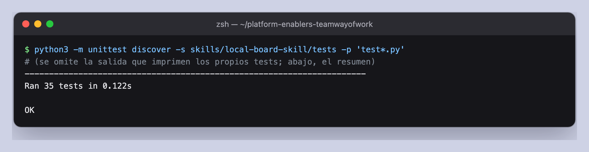

# Instalación detallada: comando por comando

> **¿Solo vas a usarla desde Cursor?** Tenés la [instalación simple](instalacion.md), que usa solo prompts. Esta guía es para
> quien quiere ver (o correr) cada comando.

| Paso | Qué hacés |
|---|---|
| [1. Requisitos](#1-requisitos) | `python3` y `git` |
| [2. Instalar](#2-instalar) | Clonar y enlazar |
| [3. Comprobar la instalación](#3-comprobar-la-instalación) | Correr los tests |
| [4. Credenciales de Jira](#4-credenciales-de-jira) | Para sincronizar |
| [5. Primer board, comando por comando](#5-primer-board-comando-por-comando) | Del `init_board.py` al plan |

> **Sobre las capturas.** Salen de ejecutar los scripts de este repo sobre un board y un repo de prueba (`~/pagos-demo`), sin
> credenciales ni red. Las rutas están acortadas. Los tests son los del repo.

---

## 1. Requisitos

| Qué | Para qué |
|---|---|
| `python3` | Todos los scripts; usan solo la biblioteca estándar (los tests corren en CI con Python 3.12) |
| `git` | `inventory_git.py` lee el historial de los repos |
| Un Jira Cloud y un token | Solo para `sync.sh` y `purge_bad_remote_links.py` |

## 2. Instalar

```bash
git clone git@github.com:josefigueredo/teamwayofwork.git && cd teamwayofwork
mkdir -p ~/.agents/skills ~/.claude/skills
ln -s "$PWD/skills/local-board-skill" ~/.agents/skills/local-board-skill
ln -s ../../.agents/skills/local-board-skill ~/.claude/skills/local-board-skill   # además, para Claude Code
```

`~/.agents/skills/` lo leen Codex, Copilot CLI, GitHub Copilot en VS Code, Cursor y Gemini CLI.

## 3. Comprobar la instalación

```bash
python3 -m unittest discover -s skills/local-board-skill/tests -p 'test*.py'
```



CI corre lo mismo y además exige 90% de cobertura:
`python -m coverage run --source=skills/local-board-skill/scripts -m unittest discover -s skills/local-board-skill/tests -p "test*.py"`
y luego `python -m coverage report --fail-under=90` (necesita `pip install coverage`).

## 4. Credenciales de Jira

Solo para sincronizar. `init_board.py` deja `<board>/sync/.env` (y un `sync/.gitignore` que lo ignora) con esta plantilla:

```bash
JIRA_BASE_URL=https://tu-empresa.atlassian.net
JIRA_CLOUD_ID=              # opcional: si está, se usa api.atlassian.com/ex/jira/<id>
JIRA_EMAIL=vos@tu-empresa.com
JIRA_API_TOKEN=el-token     # https://id.atlassian.com/manage-profile/security/api-tokens
# SSL_CERT_FILE=/ruta/al/bundle-de-CA.pem    # opcional, para redes con CA propia
```

Los scripts también aceptan `JIRA_URL` en lugar de `JIRA_BASE_URL` y `JIRA_TOKEN` en lugar de `JIRA_API_TOKEN`. `sync.sh`
carga el `.env` solo; los otros scripts leen el entorno, así que exportá las variables o cargá el archivo vos.

## 5. Primer board, comando por comando

Desde la carpeta que contiene `board/` y los repos a inventariar (el workspace):

```bash
S=~/.agents/skills/local-board-skill/scripts
python3 $S/init_board.py --board-dir board --name "Pagos DEMO" --jira-project-key DEMO --jira-label pagos-demo --entity-id-prefix PAG
python3 $S/create_asset.py --board-dir board --type epic --summary "Cobros con tarjeta"
python3 $S/create_asset.py --board-dir board --type story --parent PAGE01 --summary "Como cajero, cobro con tarjeta"
python3 $S/create_asset.py --board-dir board --type task --parent PAGS01 --summary "Reintentar cobros rechazados" --repo pagos
```


Cada `create_asset.py` imprime el identificador que generó (`Created PAGE01: …`): usalo como `--parent`. Después, la evidencia:

```bash
python3 $S/inventory_git.py --workspace . --board-dir board --since 2000-01-01
python3 $S/render_git_inventory.py --board-dir board
python3 $S/refresh_relations_catalog.py --board-dir board --workspace . --output board/sync/relations.json
python3 $S/validate_relations.py --board-dir board
```

Y el plan, que **no escribe en Jira** pero sí lo consulta, así que necesita credenciales:

```bash
$S/sync.sh board --save-plan board/sync/.review-plan.json    # revisalo
$S/sync.sh board --apply-plan board/sync/.review-plan.json   # escribe en Jira
```

Sin credenciales, ambos terminan con `ERROR: missing JIRA_EMAIL / JIRA_API_TOKEN`. Con credenciales y sin ninguna de las
dos banderas, el código de `sync_board.py` imprime `DRY-RUN: use --save-plan, review it, then use --apply-plan.` (no lo
corrí: necesita Jira).

## Referencia rápida de scripts

| Script | Qué hace | Jira |
|---|---|---|
| `init_board.py` | Estructura inicial del board | No |
| `create_asset.py` | Crea una épica, historia, tarea o subtarea con su frontmatter | No |
| `inventory_git.py`, `render_git_inventory.py` | Inventario de commits (JSON) y su reporte en Markdown | No |
| `refresh_relations_catalog.py`, `validate_relations.py`, `generate_traceability.py` | Catálogo, validación y reporte de trazabilidad del grafo | No |
| `reconcile_inventory.py`, `import_git_evidence.py`, `enrich_commit_urls.py` | Resuelven commits en evidencia o exclusiones, importan evidencia y arreglan URLs | No |
| `rebuild_index.py` | Regenera el índice del board | No |
| `sync.sh --save-plan` | Plan (dry run) con checksum | Lee |
| `sync.sh --apply-plan` | Aplica el plan verificado | Escribe |
| `purge_bad_remote_links.py` | Lista los links remotos con `.git` que borraría; los borra solo con `--apply` | Lee; con `--apply`, borra |

El orden y el criterio de cada modo (bootstrap, desde el último sync, reconciliación histórica) están en la
[referencia](referencia.md#el-contrato-del-board) y, en detalle, en el `SKILL.md`.
