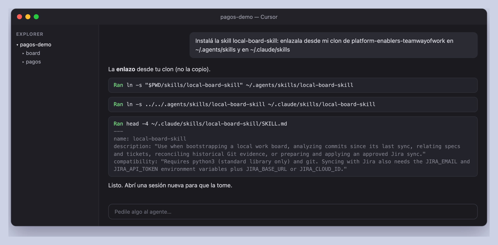
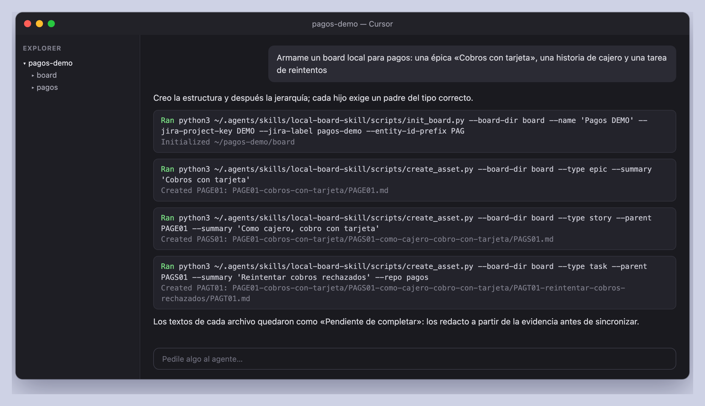
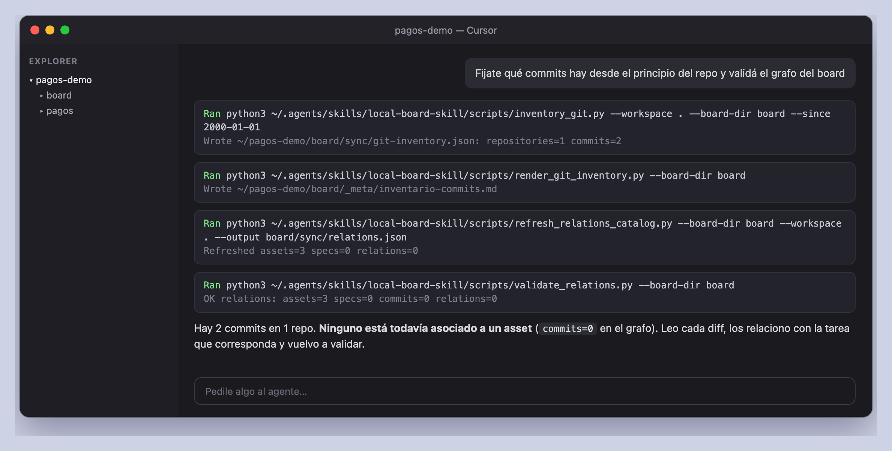
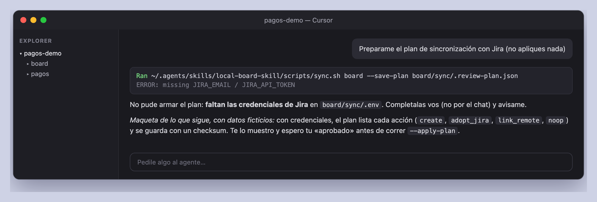

# Instalación y primer uso, desde Cursor

Todo esto se hace conversando con el agente de Cursor: le pedís las cosas y él corre los scripts por vos. Dos cosas **no** son
un prompt, y es a propósito:

- **Las credenciales de Jira** son un secreto: las guardás vos en `board/sync/.env` (o en tu entorno) y nunca las pegues en el
  chat.
- **Aprobar el plan** lo decidís vos. La skill guarda el plan y aplica *ese mismo* plan, pero la «aprobación» es una práctica,
  no una ventana ni un bloqueo técnico (ver los [límites](showcase.md#qué-protege-y-qué-no)).

> ¿Preferís ver (o correr) cada comando? Está la [instalación detallada](instalacion-detallada.md). Para ver todo lo que hace
> la skill, el [showcase](showcase.md).

| Paso | Qué hacés | Cómo |
|---|---|---|
| [1. Instalar](#1-instalar) | Dejar la skill disponible en tus agentes | Un prompt |
| [2. Credenciales de Jira](#2-credenciales-de-jira) | Guardar email, token y URL | Manual |
| [3. Tu primer board](#3-tu-primer-board) | Crear la estructura y la jerarquía | Un prompt |
| [4. Evidencia de Git](#4-evidencia-de-git) | Inventariar commits y validar el grafo | Un prompt |
| [5. Plan de sync y aprobación](#5-plan-de-sync-y-aprobación) | Preparar el plan, revisarlo, aplicarlo | Prompts |
| [6. Mantenerla al día](#6-mantenerla-al-día) | Traer la versión nueva | Un prompt |

> **Sobre las capturas.** Son **maquetas** de Cursor: muestran cómo se ve la conversación, no una sesión grabada, y el texto del
> agente es ilustrativo. Los bloques `Ran` reproducen la salida **real** de esos comandos sobre un board y un repo de prueba
> (`Pagos DEMO`). Nada de lo que habla con Jira se corrió: ahí hay prosa con datos ficticios.
> [Tabla con el origen de cada imagen](#de-dónde-sale-cada-captura).

---

## 1. Instalar

Necesitás `python3` y `git`. Abrí cualquier carpeta en Cursor y pedile:

> Instalá la skill local-board-skill: enlazala desde mi clon de teamwayofwork en ~/.agents/skills y en ~/.claude/skills



*El bloque `head` es la salida real, leyendo el `SKILL.md` a través de los enlaces creados en un `HOME` falso.*

Se enlaza, no se copia: una sola fuente de verdad. Para Claude Code hace falta además el enlace en `~/.claude/skills/`; abrí una
sesión nueva para que el agente la tome.

**Alternativa: instalar solo la skill con `npx skills`.** Si preferís no enlazar nada a mano, pedile que use el CLI
[`skills`](https://github.com/vercel-labs/skills) desde tu clon (necesitás Node):

> Instalá solo la skill local-board-skill con npx skills desde mi clon de teamwayofwork, sin telemetría

El comando es `DISABLE_TELEMETRY=1 npx skills@1.7.2 add . --skill local-board-skill -a cursor -a claude-code -g -y`. Instala una **copia**, así que **no se actualiza con `git pull`** (hay que repetir el
comando) y, si ya la habías enlazada a mano, te reemplaza el enlace por esa copia. El CLI avisa «Review skills before use; they run
with full agent permissions». Detalles, límites y la captura de su salida, en la
[instalación detallada](instalacion-detallada.md#instalar-solo-la-skill-con-npx-skills-add); el formato que cumple, en la
[especificación de Agent Skills](https://agentskills.io/specification).

## 2. Credenciales de Jira

Solo hacen falta para sincronizar (pasos 5 en adelante); todo lo anterior es local. Esto lo hacés vos.

**a) Creá un token de API** en [id.atlassian.com → Seguridad → Tokens de API](https://id.atlassian.com/manage-profile/security/api-tokens).
Se muestra una sola vez.

**b) Completá `board/sync/.env`**, con un editor, no por el chat. Lo crea `init_board.py` desde una plantilla y deja un
`sync/.gitignore` que lo ignora:

```bash
JIRA_BASE_URL=https://tu-empresa.atlassian.net
JIRA_EMAIL=vos@tu-empresa.com
JIRA_API_TOKEN=el-token-que-copiaste
```

`sync.sh` lee ese archivo automáticamente. Si definís `JIRA_CLOUD_ID`, los scripts usan `api.atlassian.com` en vez de tu sitio;
dejalo vacío salvo que sepas que lo necesitás.

## 3. Tu primer board

> Armame un board local para pagos: una épica «Cobros con tarjeta», una historia de cajero y una tarea de reintentos



*Los bloques `Ran` son salida real.*

Qué pasó: se creó `Board.md`, una carpeta `_meta/` con documentación en Markdown y una carpeta `sync/` con el grafo y el estado.
Cada entidad es un archivo, y cada hijo exige un padre del tipo correcto (una historia solo cuelga de una épica). Los
identificadores los genera la skill a partir del prefijo (acá `PAGE01`, `PAGS01`, `PAGT01`).

## 4. Evidencia de Git

> Fijate qué commits hay desde el principio del repo y validá el grafo del board



*Los bloques `Ran` son salida real.*

El inventario es solo evidencia: **leer cada diff y relacionarlo con un asset es trabajo del agente** (y tuyo, al revisar).
`validate_relations.py` rechaza nodos sueltos antes de llegar a Jira.

## 5. Plan de sync y aprobación

> Preparame el plan de sincronización con Jira (no apliques nada)



*El bloque `Ran` es la salida real **sin** credenciales. Con credenciales, el plan se guarda en `board/sync/.review-plan.json`;
esa parte es prosa ficticia.*

Con credenciales, `--save-plan` consulta Jira (de solo lectura) y guarda el plan. Revisalo con el agente y, si estás de
acuerdo, pedile:

> Aplicá el plan guardado

Antes de escribir, `--apply-plan` verifica el checksum del plan y del grafo; si algo cambió, hay que regenerar el plan. Después
de aplicar, un nuevo `--save-plan` debería traer solo acciones `noop`. **No uses un MCP de Jira ni llamadas directas a la API como
atajo**: la skill lo prohíbe en su `SKILL.md`.

## 6. Mantenerla al día

Si la enlazaste, alcanza con traer lo nuevo del clon (si usaste `npx skills`, repetí además el comando de instalación, porque instaló una copia):

> Actualizá mi clon de teamwayofwork con lo último de main

---

## Si algo falla

| Síntoma | Causa probable | Qué hacer |
|---|---|---|
| `ERROR: missing JIRA_EMAIL / JIRA_API_TOKEN` | Faltan credenciales en `board/sync/.env` o en el entorno | Paso 2 |
| `missing JIRA_CLOUD_ID or JIRA_BASE_URL` | No hay URL de Jira | Definí `JIRA_BASE_URL` (paso 2) |
| `JIRA_BASE_URL/JIRA_URL debe usar HTTPS` | La URL empieza con `http://` | Usá `https://` |
| `story requiere un parent existente de tipo epic` | Pasaste un padre que no existe o de otro tipo | Creá primero la épica y usá su identificador |
| El plan guardado ya no aplica | Cambió el grafo, las entidades o Jira | Regenerá con `--save-plan` y revisalo de nuevo |
| La skill no aparece en el agente | Sesión abierta antes de crear los enlaces | Abrí una sesión nueva |

## De dónde sale cada captura

| Imagen | Origen |
|---|---|
| `cursor-instalar.png` | Maqueta; el `head` es real a través de enlaces en un `HOME` falso |
| `terminal-npx-skills.png` | **Real**: salida de `npx skills@1.7.2 add` y del listado de lo instalado, en un `HOME` falso (sin telemetría); se ve en la [instalación detallada](instalacion-detallada.md#instalar-solo-la-skill-con-npx-skills-add) |
| `cursor-crear.png` | Maqueta; los `Ran` son la salida real de `init_board.py` y `create_asset.py` (board de prueba) |
| `cursor-evidencia.png` | Maqueta; los `Ran` son la salida real sobre un repo de prueba con dos commits |
| `cursor-sync.png` | Maqueta; el `Ran` es el error real sin credenciales, el resto es prosa ficticia |

Los HTML de origen están en [`img/src/`](img/src/).
