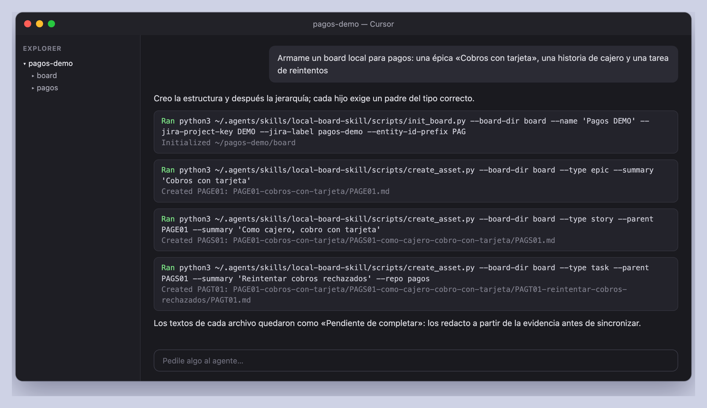
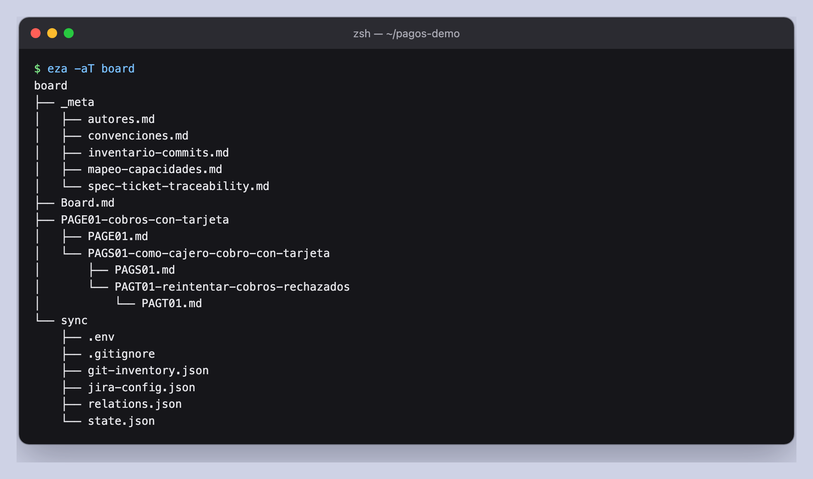
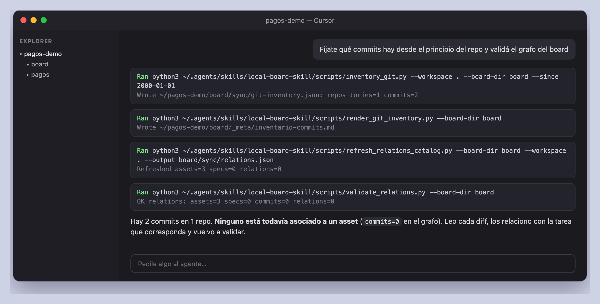
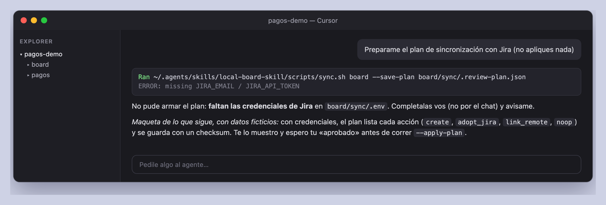

# Showcase

Qué se puede hacer con `local-board-skill`, escenario por escenario: qué le decís al agente, qué corre por detrás y qué ves.
Para instalarla, la [guía con prompts de Cursor](instalacion.md) o la [detallada](instalacion-detallada.md); para el contrato del
board y la configuración de Jira, la [referencia](referencia.md).

| Pieza | Escenario | Ir al caso |
|---|---|---|
| `init_board.py`, `create_asset.py` | «Armame un board local para este proyecto» | [Armar un board](#1-armar-un-board-local) |
| `inventory_git.py` y el grafo | «¿Qué commits hay desde el último sync?» | [Relacionar commits](#2-relacionar-commits-con-el-board) |
| `sync.sh --save-plan` | «Preparame el plan de sync con Jira» | [Preparar el plan](#3-preparar-el-plan-de-sync) |
| `sync.sh --apply-plan` | «Aplicá el plan que aprobé» | [Aplicar el plan](#4-aplicar-el-plan-aprobado) |
| `purge_bad_remote_links.py` | «Limpiá los links remotos con `.git`» | [Limpiar links](#5-limpiar-links-remotos-mal-formados) |

> **Sobre las salidas.** Los casos 1 y 2 muestran salida **real** de los scripts sobre un board y un repo de prueba. En el 3 solo
> es real el error sin credenciales. Los casos 4 y 5 escriben en Jira y no se corrieron: ahí hay prosa con datos ficticios, sin
> salida inventada.

---

## Lo que la distingue

| | |
|---|---|
| **El board vive en Markdown junto al código** | Épicas, historias, tareas y subtareas son archivos versionados, no la cabeza de alguien ni solo Jira |
| **Cada entidad se traza a su evidencia** | Un grafo explícito relaciona assets con commits, specs y PRs; las URLs salen de remotes de Git verificados |
| **Jira es la última etapa** | Primero un plan (dry run) con checksum, se revisa y recién se aplica ese plan |
| **No duplica** | Antes de planear un `create`, busca en Jira por el marcador `[id-del-asset]` y adopta el issue si coincide exactamente |
| **Un plan viejo no se aplica** | Si cambió el grafo, la identidad o la evidencia, hay que regenerar el plan |

---

## 1. Armar un board local

**Piezas:** `init_board.py`, `create_asset.py` · **Escribe en Jira:** no.

*Maqueta de la conversación; los bloques `Ran` son salida real.*

El resultado, en disco:

Cada hijo valida a su padre: una historia solo cuelga de una épica, una tarea de una historia. Si te equivocás, el script no crea
nada y dice por qué (`story requiere un parent existente de tipo epic`). Los archivos nacen con secciones «Pendiente de
completar»: la skill pide redactarlas con evidencia y sin inventar requisitos antes de sincronizar.

## 2. Relacionar commits con el board

**Piezas:** `inventory_git.py`, `render_git_inventory.py`, `refresh_relations_catalog.py`, `validate_relations.py` ·
**Escribe en Jira:** no.

El inventario es **solo evidencia**. Decidir a qué asset corresponde cada commit exige leer el diff, y eso lo hace el agente
(y lo revisás vos). Las reglas del grafo: cada commit usa su hash completo y tiene una o más relaciones `evidence_for`, o una
excepción `excluded_with_reason`; los scripts rechazan nodos sueltos antes de llegar a Jira. Los otros dos modos
(«desde el último sync» y «reconciliación histórica») usan las mismas piezas con otro punto de partida: ver la
[referencia](referencia.md#el-contrato-del-board).

## 3. Preparar el plan de sync

**Pieza:** `sync.sh --save-plan` · **Escribe en Jira:** no, pero **consulta** Jira (necesita credenciales y red).

Con credenciales, el plan lista una acción por entidad: `create`, `adopt_jira`, `update_jira`, `update_local`, `link_remote` o `noop`, y se guarda
con un checksum del plan y del grafo. Una jerarquía nueva entera (épica → historia → tarea → subtarea) es un plan válido: los
padres se resuelven al aplicar.

**Si falla:** sin credenciales corta con `ERROR: missing JIRA_EMAIL / JIRA_API_TOKEN`; con candidatos ambiguos o contradictorios
en Jira, falla explícitamente en vez de elegir uno.

## 4. Aplicar el plan aprobado

**Pieza:** `sync.sh --apply-plan` · **Escribe en Jira:** sí. *Maqueta en texto, datos ficticios; no se corrió.*

> **Vos:** aplicá el plan guardado
>
> **Agente (maqueta):** Verifico el checksum del plan y del grafo. Aplico en orden jerárquico: primero la épica, luego la
> historia, la tarea y la subtarea, guardando cada clave de Jira antes de crear al hijo. Los `link_remote` van en paralelo,
> uno por issue. Al terminar corro de nuevo `--save-plan`: tendría que traer solo `noop`.

Si un `create` falla a mitad de camino, lo creado queda registrado localmente; si un candidato adoptado cambió, la corrida
**se detiene** y pide regenerar el plan; nunca lo reemplaza por un `create`. La velocidad se ajusta con `JIRA_SYNC_WORKERS`
(12 por defecto) y `JIRA_WRITE_THROTTLE` (por ejemplo `0.3`), como describe el `SKILL.md`.

## 5. Limpiar links remotos mal formados

**Pieza:** `purge_bad_remote_links.py` · **Escribe en Jira:** **borra, sin plan ni dry run.** *No se corrió.*

Recorre los issues del board y borra los links remotos cuya URL termina en `.git` o contiene `.git/`. A diferencia de la
sincronización, **no tiene `--save-plan`, ni confirmación, ni modo de prueba**: corre directo con tus credenciales sobre
todos los issues del board que tengan `jira_key`. Pedile al agente que no lo corra sin que vos lo hayas pedido
explícitamente, y tené presente que no se puede deshacer desde acá.

---

## Qué protege y qué no

| Te protege de… | Cómo |
|---|---|
| Crear duplicados en Jira | Busca por el marcador exacto y adopta un único candidato que coincida en proyecto, tipo, resumen y label |
| Aplicar un plan desactualizado | `--apply-plan` verifica el checksum del plan y del grafo |
| Un grafo roto | Los scripts rechazan nodos sueltos y evidencia sin resolver |
| Inventar URLs | Las URLs de commits y PRs se derivan solo de remotes de Git verificados |
| Credenciales en el repo | `init_board.py` deja un `sync/.gitignore` que ignora `.env` |

| **No** te protege de… | Por qué |
|---|---|
| Aplicar sin que nadie revise el plan | La «aprobación» es una práctica de la skill: `--apply-plan` solo comprueba el checksum, no pide un clic ni una confirmación |
| El borrado de links de Jira | `purge_bad_remote_links.py` no tiene plan ni dry run |
| Un mal agrupamiento funcional | Decidir qué commit va a qué asset es interpretación; ante ambigüedad material, la skill pide parar y consultarte |

**Cuando algo falla:** los errores de configuración cortan antes de tocar Jira (`missing JIRA_EMAIL / JIRA_API_TOKEN`,
`missing JIRA_CLOUD_ID or JIRA_BASE_URL`, HTTPS obligatorio). Un padre sin resolver detiene la aplicación en vez de crear un hijo
huérfano.
